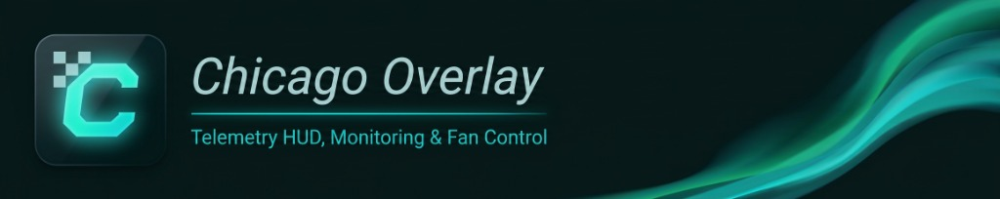
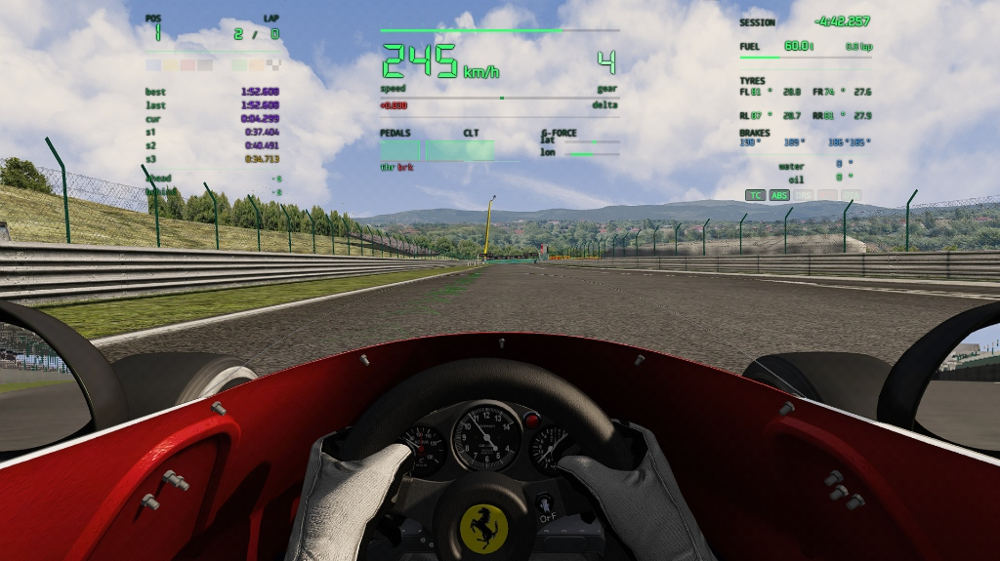
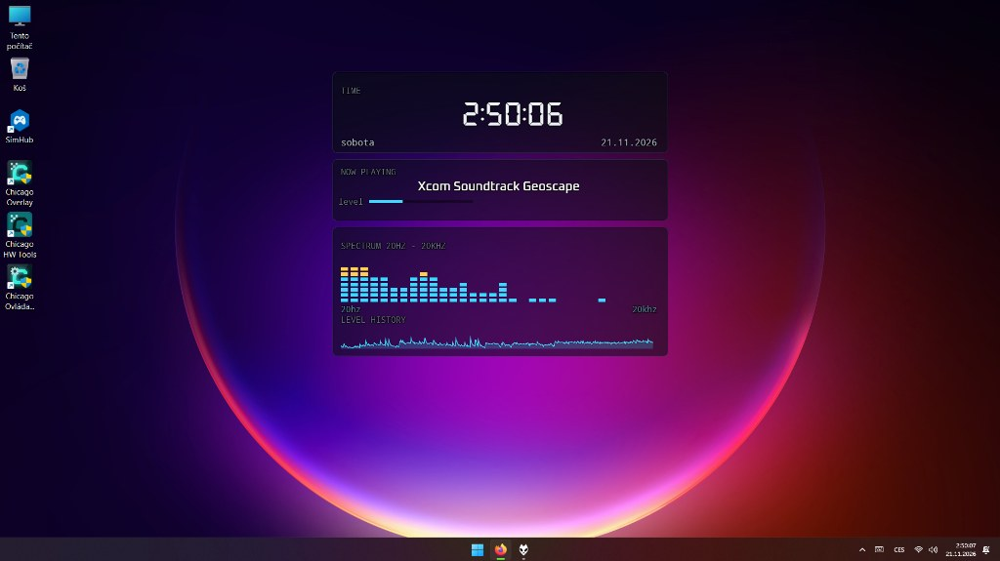
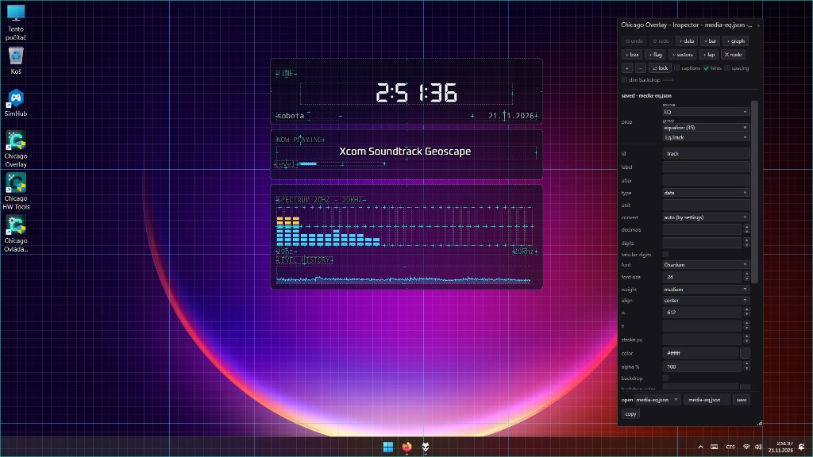
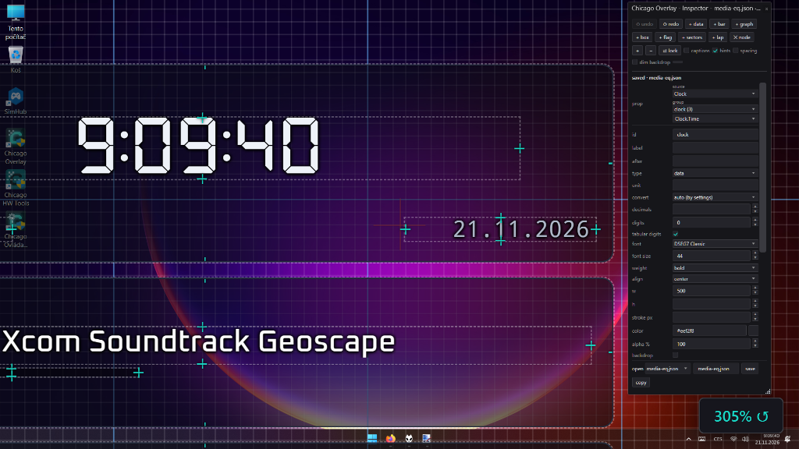
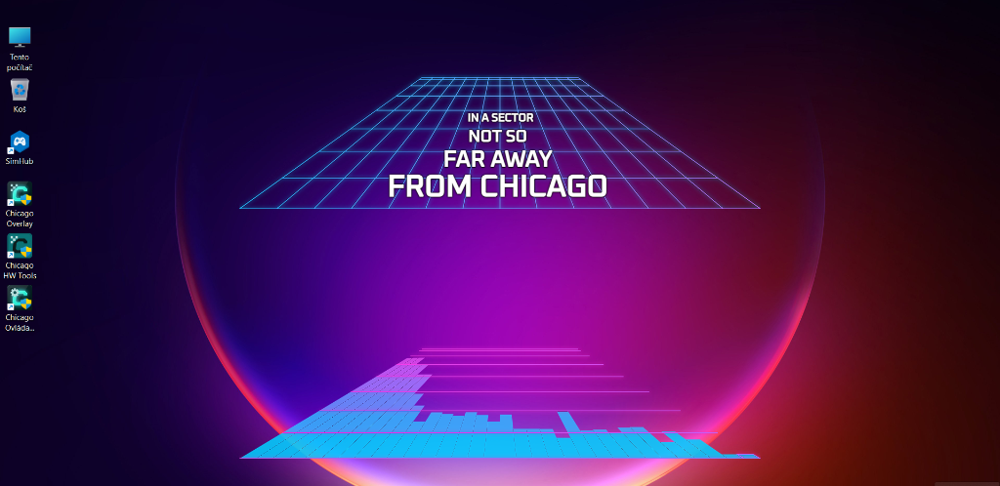

**Lehký, plně přizpůsobitelný telemetrický a systémový HUD overlay pro Windows 10/11 na víc monitorů.**
Postavený pro simracing (přes SimHub), sledování hardwaru PC a bezpečné řízení ventilátorů na úrovni hardware — ale hlavně je to vrstva, co Windows nikdy neměly: vizuální stavitel widgetů pro cokoliv, co tvůj počítač ví. Editor drag-and-drop, 600+ datových zdrojů, texty, lišty, grafy i obrázky kdekoli na každé obrazovce — bez jediného řádku kódu. Závodní HUD v sobotu, PC dashboard v neděli — stejný motor, tvůj layout.

**600+ živých propů — každý přetáhneš na plátno drag-and-drop editorem: HUD, pilulka, widget nebo RTSS overlay přímo ve hře. Nula kódu, vzhled je 100% tvoje fantazie.**

---

### Hlavní funkce

* **Univerzální telemetrie a systémová data:**
  * **Simracing (SimHub Bridge):** plná podpora 900+ SimHub propů (rychlost, otáčky, rychlostní stupeň, živá delta, časy sektorů a kol s automatickými barvami purple/green/yellow, odstupy, teploty a tlaky pneu a brzd, palivo, vlajky, grafy pedálů). Běží plný licencovaný 60 Hz tick s delta rámci (po drátě putují jen změněné hodnoty), cachované akcesory a bindovatelné akce tlačítek volantu — minimální zátěž CPU. Včetně automatické instalace pluginu a kontroly verze.
  * **DirectX FPS a frametimes:** FPS nezávisle na výrobci, grafy frametime a CPU/GPU frame časy přes Intel PresentMon (funguje v borderless i fullscreenu).
  * **Hardwarové senzory:** teploty CPU/GPU, spotřeba ve Wattech, vytížení, RAM, teplotní čidla desky a otáčky ventilátorů přes LibreHardwareMonitor a podepsaný ovladač PawnIO.
  * **Síťová telemetrie:** ping, ztráta paketů % a down/up throughput (kB/s) — s nastavitelnými cíli pingu (seznam adres v Nastavení, vlastní adresy, cyklování zkratkou; `Net.Target` ukazuje aktivní). Pro online závody i běžný monitoring; použitelné v pravidlech upozornění (hlasová výstraha „ztráta paketů").
  * **Plocha a média:** hodiny, datum a audio spektrum v reálném čase (8 volitelných EQ enginů) s info o aktuální skladbě.
* **Vestavěný vizuální HUD builder (`Ctrl+Alt+E`):**
  * Přetahování myší, hromadný výběr prvků, přichytávání k mřížce se zvýrazněnými hlavními linkami, zaměřovač přes obrazovku a ztmavení podkladu při úpravách.
  * Bohaté vizuální prvky: datové hodnoty, bary (plné, gradient, HSL spektrum, LED segmenty, svit, zrcadlový odraz), křivkové grafy, vlajky, sektory, časy kol, stavové boxy — a **obrázkové prvky** pro loga týmů, branding kanálu, odznaky nebo jakýkoli obrázek — nutnost, když HUD zároveň slouží jako stream overlay (fit módy, průhlednost, podklad, radius rohů, průhlednost PNG).
  * Pravý klik na prvek = **pořadí vrstev** — dopředu / o úroveň vpřed / o úroveň zpět / dozadu funguje napříč typy, skupiny se hýbou jako blok, plná podpora undo.
  * **Chytrá podmíněná pravidla:** tříúrovňové barevné prahy, blikající výstrahy a podmínky zobrazení (`<`, `<=`, `=`, `!=`, `>=`, `>`) bez jediného řádku kódu.
* **Widgety na ploše — vrstva, co Windows nikdy neměly:**
  * Volně plovoucí nativní widgety (pilulky) kreslené vestavěným WPF enginem — **nula WebView2, minimum RAM**. Připneš je k libovolné hraně obrazovky, nebo přepneš na **volný režim** a zaparkuješ kamkoliv s přesnými X/Y.
  * **Chyť a táhni je přímo po ploše** v Edit módu (`Ctrl+Alt+E`) — pozice se sama uloží a po dokončení se vrací click-through.
  * Pro každý widget: vodorovná či svislá orientace, vlastní jméno (vidět v tray submenu), **hotová témata** místo nekonečného ladění barev, celková průhlednost + zvlášť alfa podkladu a radius rohů (defaultně kapsle, `0` = hranaté).
  * Každý widget je řada (nebo sloupec) živých hodnot s vlastním skinem — FPS, frametimes, CPU, RAM, zátěž a teplota GPU… co zdroj vybereš. `start-widget` je v balení hned od první instalace, widgety se přepínají rovnou z tray menu a spravuje je samostatné okno Widgety.
* **Render motor na každý monitor zvlášť:**
  * `webview` nebo `native` per display — nativní engine kreslí `data` a `box` nody layoutu přímo ve WPF, **úplně bez WebView2 procesu** na dané obrazovce: míň RAM, okamžité kreslení a fixní číslicové sloty, takže hodnoty nikdy neposkakují. Layout jen s pilulkou nepustí WebView vůbec — monitor jede native automaticky a `Ctrl+Alt+I` ukáže, který engine kde skutečně běží.
* **RTSS OSD do hry:**
  * Živý text libovolného widgetu proudí do **RivaTuner Statistics Server** sdílené paměti — statistiky přímo ve hrách a exkluzivním fullscreenu, kam se běžný overlay nedostane (ověřeno naživo s RTSS 7.3.7).
* **Chytré hlídání zdrojů — fajfka = povolení, běh = poptávka:**
  * Povolený zdroj už neběží jen proto, že appka je otevřená. EQ, hodiny, HW monitoring i PresentMon naskočí jen dokud je něco čte (layout, widget, RTSS stream, alert, živá relace, řízení větráků, otevřené HW okno) — a zhasnou, jakmile je nikdo nepotřebuje. Ikona v tray = klidová appka.
  * **Chicago hlídá samo sebe:** propy `App.*` ukazují vlastní CPU, privátní i sdílenou RAM, počet WebView procesů a jejich cenu, vlákna, počty oken a stav každého zdroje. Stránka **Zdroje** ukazuje živou spotřebu i *proč* každý zdroj běží nebo stojí.
* **Auto profily (HUD podle hry):**
  * Layout se přepne automaticky při spuštění hry nebo libovolného procesu — závodní HUD po startu, po vypnutí zpátky na čistou plochu. Detekce podle názvu procesu nebo hry ze SimHubu (částečná shoda).
  * Pro jednotlivé nebo všechny monitory, včetně pravidel „HUD vypnutý" — třeba závod na hlavním monitoru a postranní zhasnuté.
* **Řízení ventilátorů (bezpečné, na úrovni hw):**
  * Ovládání hlaviček ventilátorů desky (SuperIO čip přes PawnIO), větráků GPU i USB řadičů — auto / manuální % / teplotní křivka.
  * Křivky s 2–6 táhly a hysterezí pro každou křivku; identifikace roztočí kanál na 100 %, aby bylo poznat, který větrák to fyzicky je.
  * **Teplotní ikony v tray:** libovolný teplotní zdroj větráku může žít v tray jako průhledná ikona s živou hodnotou — LED „segmentové" číslice (default) nebo klasický mono font, akcent nebo vlastní barva na větrák.
  * Dedikované **okno Větráky** z tray menu, plus vestavěná varování na chybějící admin práva a konflikty s jiným fan-control softwarem.
  * Bezpečí vestavěné: spodní limit 20 %, okamžitý návrat na hardware-auto při kritické teplotě a hlídací guardian proces, který vrátí řízení i při pádu aplikace.
* **Mapování tlačítek a kláves (volant/button-box friendly):**
  * Binduj libovolnou klávesu nebo tlačítko volantu / button boxu (až 16 zařízení × 32 tlačítek) na dedikované stránce Zkratky — cyklus layoutů, HUD zap/vyp, edit mód, identifikace monitorů, větráky zap/vyp nebo spuštění stress testu.
  * Funguje i ve hře; cyklování layoutů nabízí výběr monitoru a volitelnou hlasovou hlášku názvu layoutu — šikovné pro VR.
* **HW info — PC na jeden pohled:**
  * Verze Windows, BIOS, deska, CPU (jádra/socket/takt), GPU (VRAM/ovladač), moduly RAM a disky s kapacitou — v okně z tray, na stránce v nastavení i v přiloženém layoutu `hw-info`. Kompletní přehled o PC na jednom místě.
* **Reporty relací a vestavěný stress test:**
  * Po každé herní relaci se zapíše souhrn (průměr fps, 1 % low, max teploty a spotřeby CPU/GPU, délka) — prohlížení v samostatném okně Relace (tray menu nebo Nastavení), mazání nebo ignorování aplikací, které nesledovat.
  * Vestavěný stress test CPU (0–100 % na všechna jádra), GPU (WebGL shader) a RAM (alokace MB) — ideální pro ladění křivek ventilátorů a layoutu `tune-lab` bez externích nástrojů.
* **Upozornění a detekce bottlenecku:**
  * Pravidla „klíč >= / <= hodnota" nad libovolnou telemetrií s pípnutím nebo hlasovou hláškou Windows (s pauzou mezi opakováním).
  * Klíče `Sys.Limit` / `Sys.Throttle` ukážou, co brzdí FPS — GPU, CPU nebo teplotní throttle.
* **Úklid systému s režimem T800:**
  * Hloubkový úklid Windows a dat prohlížečů na jeden klik: temp soubory, logy, cache, optimalizace doručení, komponenty WinSxS (DISM), cache fontů a miniatur, zbytky po aktualizacích, historie Defenderu a diagnostiky a další — každá položka označená rizikovou úrovní (bezpečné / nebezpečné / soukromí / uživatelská data).
  * Volitelný režim **T800** smaže i zamčené soubory: ukončí procesy, které je drží — s ochranou sebe sama, vlastních potomků a všeho označeného jako kritické pro systém — a zbytek naplánuje ke smazání při příštím startu. Tichý úklid běží i z kontextového menu koše.
* **Správce spuštění a úloh:**
  * Všechno, co startuje s PC, v jednom okně — registry Run klíče, složky spuštění, služby i všechny naplánované úlohy (typ triggeru, příští a poslední běh, spustit, zakázat a smazat pro nesystémové záznamy).
* **Ovládání z příkazovky (`/help`):**
  * Jedno exe, hodně přepínačů (`/x`, `-x` nebo `--x`): skok rovnou do libovolného okna (`/settings`, `/widgets`, `/cleaner`, `/startup`, `/fans`, `/hwinfo` …), volba režimu (`/tools`, `/lite`, `/full`), tichý úklid (`/clean`, `/clean-bin`) nebo nastavení stavu startu bez zápisu do settings (`/debug`, `/applog`, `/source`, `/lang`, `/scale`, `/layout`).
  * Instalátor přidává volitelnou ikonu **„Chicago Control Center"** na plochu, která otevírá Ovládací centrum přímo (`/settings`) — šikovné, kdyby byla tray ikona nedostupná. Zástupce zkopíruj, změň parametr a připni libovolné okno na plochu.
* **Chicago HW Tools — dedikovaný režim ladění PC:**
  * Nezávodíš? Použij Chicago jako útlý nástroj pro ladění PC: řízení ventilátorů s křivkami, teplotní ikony v tray, HW info, živý ping/ztráty, stress test, reporty relací, úklid systému a upozornění — s overlayem, SimHub pluginem a WebView2 úplně vypnutými.
  * Instaluje se jako volitelná komponenta s vlastní zástupce **„Chicago HW Tools"** a ikonou — nebo spusť kdykoli přes `chicago.exe --tools`. Hlavní appka umí zlehka i s `/lite`.
* **Skutečná podpora více monitorů a úspora RAM:**
  * Každý monitor může mít vlastní layout i nezávislou obnovovací frekvenci (Plná / 60 / 30 / 20 / 10 / 5 Hz).
  * Volba mezi **sdíleným plátnem** (jeden WebView2 renderer pro všechny monitory — úspora ~140 MB RAM na každý další monitor) nebo **oddělenými okny**.
  * Laděné na téměř nulovou cenu CPU: hw init a rescan běží na pozadí, telemetrie jede na delta rámcích a nečinná práce je blokovaná — overlay zůstává svižný a neviditelný, dokud nemá co ukázat.
* **20 vyladěných šablon v balíčku:**
  * Obsahuje `start`, `race-minimal`, `race-hud`, `race-pro`, `race-pro-2`, `race-hw`, `system-hw`, `system-hud`, `hw-info`, `maxi-hw`, `media-eq`, `media-hud`, `media-hud-2`, `combo-desk`, `combo-hud`, `tune-lab` (ladění křivek a stressu), `flat-stage`, `persp-stage`, `pill-hw` (demo nativního widgetu) a `sci-fi`.
* **7 jazyků a nativní vzhled Windows 11/10:**
  * V **češtině, angličtině, němčině, španělštině, francouzštině, italštině a polštině** (instalátor i appka). Kopíruje akcentovou barvu Windows a dark/light režim — nebo zvol vlastní akcent; značková teal `#18D4C2` je předvybraná na čisté instalaci (tvoje volba se nikdy nepřepíše).

---

### Full nebo HW Tools — volba při instalaci

Jeden instalátor, dvě edice. Vybíráš hned po úvodní stránce — a druhou edici můžeš kdykoli spustit později, žijí vedle sebe.

|| **Full** | **HW Tools** |
|---|:---:|:---:|
| HUD overlay, layouty a vizuální editor | ✓ | — |
| SimHub závodní telemetrie | ✓ | — |
| Media info a audio spektrum | ✓ | — |
| FPS a frametimes (PresentMon) | ✓ | ✓ |
| Řízení ventilátorů, křivky a guardian | ✓ | ✓ |
| HW info, senzory a síťový monitoring | ✓ | ✓ |
| Stress test, reporty relací a upozornění | ✓ | ✓ |
| Úklid systému a správce spuštění/úloh | ✓ | ✓ |
| Nastavení, aktualizace, autostart, 7 jazyků | ✓ | ✓ |
| WebView2 runtime naložený | ✓ | nikdy |

*Obě edice mají vlastní zástupce ve Start menu (desktop volitelný). HW Tools je stejné `chicago.exe` v dedikovaném režimu `--tools` — bez overlaye, bez SimHubu, minimální RAM.*

---

### Rychlý start

1. **Instalace:** Spusť `chicago overlay setup <ver>.exe` (~70 MB, včetně prerekvizit .NET 8 a WebView2). Instalátor automaticky detekuje `.NET 8` / `WebView2` a nainstaluje plugin `Chicago.Bridge.dll` přímo do složky SimHubu.
2. **Povolení v SimHubu:** Otevři SimHub a povol plugin **Chicago Overlay** (nebo použij jednoklik instalátor/updater v tray menu appky či *Nastavení → Zdroje*).
3. **Přizpůsobení:** Stiskni **`Ctrl+Alt+E`** kdykoli pro **Edit mód** a otevření Inspektoru. **`Ctrl+Alt+H`** přepíná viditelnost HUDu, **`Ctrl+Alt+I`** identifikuje monitory.

---

### Stažení

Stáhni nejnovější `chicago_overlay_<ver>.zip` z **[Releases](../../releases)**, rozbal a spusť setup uvnitř (prerekvizity .NET 8 + WebView2 jsou v balení). Vestavěný update checker upozorní na nové verze.

---

### Příběh projektu (Slovo autora)

Chicago Overlay nevznikl v moderní kanceláři — celý projekt byl napsán a odladěn v **obytném karavanu Wohnwagenwerk z roku 1984**, který je mým domovem. Svým způsobem to k motorsportu krásně sedí: rok 1984 byl zlatou érou Formule 1, kdy závodníci i konstruktéři bydleli a pracovali přímo ve svých karavanech v padoku.

Protože bydlím v místě, kde pro mě na trhu práce není uplatnění, stal se vývoj tohoto nástroje cestou, jak zúročit zkušenosti staré počítačové školy — s důrazem na poctivé řemeslo, žádná tichá selhání a maximální ohled na každý megabajt paměti i každé FPS.

**Vaše zpětná vazba určuje další směr:**
Každý nápad, názor, hlášení chyby nebo vlastní layout od komunity je upřímně vítán. Pokud bude o nástroj zájem, rád ho budu rozvíjet dál a mohu nabídnout i individuální přístup při ladění pro jednotlivce nebo e-sportové týmy.

Pokud vám Chicago Overlay dělá radost a chcete podpořit jeho další vývoj (nebo mi jen pomoct v nelehké životní situaci), jakýkoliv dobrovolný příspěvek pro mě bude mít obrovskou hodnotu — nejen jako uznání odvedené práce, ale i jako skutečná pomoc:

**[Podpořit přes Ko-fi (Karta / Apple Pay / Google Pay / PayPal)](https://ko-fi.com/radimsvatek)**

*P.S. Projekt má pořád 0 hvězdiček — když ti Chicago udělá radost, kliknutí na ⭐ nic nestojí a hrozně pomůže, aby ho vůbec někdo našel.*

Díky za vyzkoušení — vidíme se na trati!

---

### Licence a distribuce

* **Aplikace (`Chicago Overlay`):** **Donationware / Freeware** — zcela zdarma ke stažení i používání, bez uzamčených funkcí či předplatného. Pokud se hodí, jakýkoli dobrovolný příspěvek přes [Ko-fi](https://ko-fi.com/radimsvatek) je velmi vítán. Šíření upravených binárek nebo komerční prodej bez svolení není povolen.
* **Zdrojový kód:** není veřejný — autor si ho nechává privátní. Jakékoli použití kódu v jiných projektech nebo produktech vyžaduje svolení autora.
* **Layouty a jazykové balíčky (`.json`):** volné k použití, úpravám a sdílení v komunitě.
* **Záruka:** software je poskytován „tak jak je", bez jakékoli záruky. Použití na vlastní riziko.
