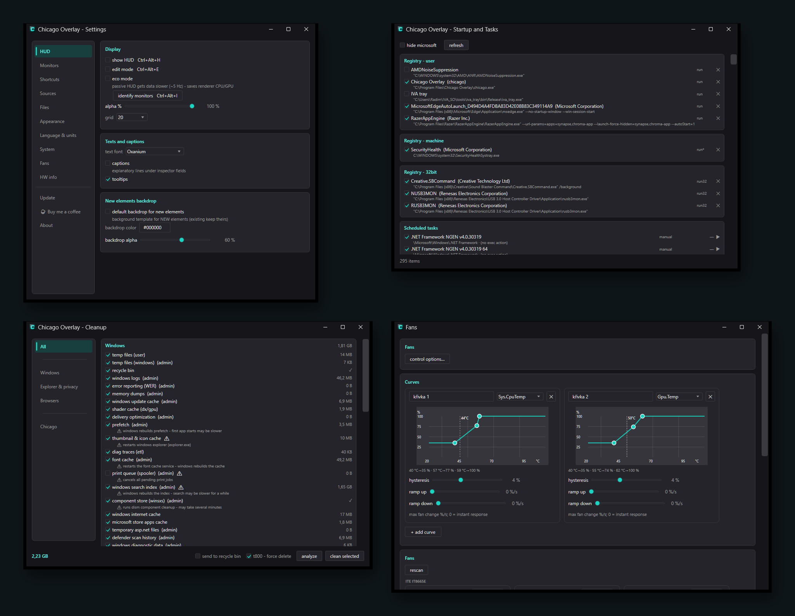

https://github.com/user-attachments/assets/f295d1df-57e7-49dc-af6d-08ef3f8c6a13

*▶ [Přehraj 1.5 teaser video (mp4)](https://github.com/RadimSvatek/chicago-overlay/releases/download/v1.5.527/chicago1_5.mp4)*

*Od dob projektu Chicago systému Windows něco scházelo - vrstva, která je víc než módní doplněk. A tak jsem ji spojil.*

**Lehký, plně přizpůsobitelný telemetrický a systémový HUD overlay pro Windows 10/11 na víc monitorů.**
*Windows 10 už Microsoft nepodporuje. Chicago Overlay by mělo stále běžet, ale tato konfigurace není testovaná ani zaručená.*
Postavený pro simracing (přes SimHub), sledování hardwaru PC a bezpečné řízení ventilátorů na úrovni hardware - ale hlavně je to vrstva, co Windows nikdy neměly: vizuální stavitel widgetů pro cokoliv, co tvůj počítač ví. Editor drag-and-drop, 1 400+ datových zdrojů, texty, lišty, grafy i obrázky kdekoli na každé obrazovce - bez jediného řádku kódu. Závodní HUD v sobotu, PC dashboard v neděli - stejný motor, tvůj layout.

**2 269 bindovatelných propů - 787 vestavěných + 1 482 z celé SimHub telemetrie. Každý přetáhneš na plátno drag-and-drop editorem: HUD, pilulka, widget nebo RTSS overlay přímo ve hře. Nula kódu, vzhled je 100% tvoje fantazie.**

---

### Proč je to jiné

Většina hardware a telemetrických nástrojů končí pasivní tabulkou ve vlastním okně. Chicago Overlay jde dál - čtyři vrstvy, jeden datový motor:

- **Kompletní HW diagnostika a inventura** - detekce na úrovni nejlepších - like CPU-Z, GPU-Z nebo HWiNFO, v čisté prohledávatelné tabulce s CSV exportem (787 vestavěných propů + 1 482 ze SimHub telemetrie = **2 269 celkem**).
- **Vícenásobný vizuální výstup** - WebView canvas, nativní WPF nebo RTSS text. Jakoukoliv hodnotu z tabulky pošleš rovnou na obrazovku, do hry v exclusive fullscreenu nebo na druhý monitor.
- **Dva režimy ovládání** - Easy režim pilulek/widgetů: klikneš, vybereš skin a hodnoty, přetáhneš myší - hotovo za 10 sekund, bez WebView2. Pokročilý inspektor (`Ctrl+Alt+E`): plná tvůrčí svoboda bez kódu - zoom 25-800 %, 3D perspektivní gridy, ekvalizér, vlastní grafy, vrstvy, sdílení přes schránku.
- **Poctivé systémové nástroje navrch** - křivky ventilátorů s guardianem, stress test CPU/GPU/RAM, rychlý T800 čistič a správce Start & Tasks v jediné lehké aplikaci.

---

### Hlavní funkce

* **Univerzální telemetrie a systémová data:**
  * **Simracing (SimHub Bridge):** plná podpora 1 400+ SimHub propů (rychlost, otáčky, rychlostní stupeň, živá delta, časy sektorů a kol s automatickými barvami purple/green/yellow, odstupy, teploty a tlaky pneu a brzd, palivo, vlajky, grafy pedálů). Běží plný licencovaný 60 Hz tick s delta rámci (po drátě putují jen změněné hodnoty), cachované akcesory a bindovatelné akce tlačítek volantu - minimální zátěž CPU. Včetně automatické instalace pluginu a kontroly verze.
  * **DirectX FPS a frametimes:** FPS nezávisle na výrobci, grafy frametime a CPU/GPU frame časy přes Intel PresentMon (funguje v borderless i fullscreenu).
  * **Hardwarové senzory:** teploty CPU/GPU, spotřeba ve Wattech, vytížení, RAM, teplotní čidla desky a otáčky ventilátorů přes LibreHardwareMonitor a podepsaný ovladač PawnIO.
  * **Síťová telemetrie:** ping, ztráta paketů % a down/up throughput (kB/s) - s nastavitelnými cíli pingu (seznam adres v Nastavení, vlastní adresy, cyklování zkratkou; `Net.Target` ukazuje aktivní). Pro online závody i běžný monitoring; použitelné v pravidlech upozornění (hlasová výstraha „ztráta paketů").
  * **Plocha a média:** hodiny, datum a audio spektrum v reálném čase (8 volitelných EQ enginů) s info o aktuální skladbě.
* **Mapa - postav si vlastni lod (nove pojeti ovladani):**
  * Kazda komponenta appky - kazda stranka nastaveni, kazdy datovy kanal - zije jako **modul na volnem platne**, ktere si usporadas sam. Sestav vlastni lod jako stanici: tahni moduly kamkoliv, dej kazdemu vlastni velikost, vlastni obrazek nebo vlastni pismo a nastav mapu na vlastni obrazek pozadi. Zadne pevne menu - tvoje usporadani JE rozhrani, zapamatovatelne protoze jsi ho postavil ty.
  * **Magnetizace ve stylu Winampu:** hrany modulu se pri tazeni prichytavaji k sobe a moduly co se dotykaji hranou se propoji viditelnym kloubem - propojene komponenty se doslova dokuj k sobe.
  * Pravy klik na modul = **vlastnosti**: velikost, vlastni obrazek, vlastni pismo - a u hw komponent **fajfka "spoustet jako spravce"**, takze admin prava jsou jen tam, kde jsou opravdu potreba, a webview za nimi netrpi.
  * Nastaveni mapy je pod jednim tlacitkem: mrizka na pozadi, magnetizace, vychozi velikost modulu, vlastni pozadi, reset. **Fullscreen (F11)** meni mapu na dedikovanou ovladaci plochu. Instalator dava zastupce "Chicago Mapa" na plochu i do Startu - nebo `chicago.exe /map`.
  * 📖 **[Tahak Mapy a navody na témata](MAP.md)** - triky prostorove pameti, bezpecnost per modul a stavby (ISS, pudorys, talent tree, Winamp rack).

* **Otevrene datove kanaly - lod mluvi s celou domacnosti (experimental):**
  * Kazdy kanal je JSON soubor v `data\` - appka ho precte, zdroj spusti a jeho hodnoty pristanou na stejne sbernici props jako telemetrie: bindovatelne do layoutu, widgetu, aur, alertu i maker bez radku kodu. Vsechno bezi na poptavku - kanal zije jen kdyz ho neco cte.
  * **Chytra domacnost a IoT:** MQTT subscribe (topicy s wildcardy, JSON payloady se rozsplaskati na props) + zpetny kanal `mqtt:pub`; Home Assistant pres websocket API (zive `state_changed` push + volani sluzeb `ha:`); univerzalni HTTP/JSON poller s vlastnimi hlavickami (Bearer/API klice, DPAPI sifrovane tajemstvi) a zapis `http:post`.
  * **Sit:** routery pres UPnP/SNMP plus nativni REST pro MikroTik, OpenWrt, UniFi a ASUSWrt (WAN ip/up/mbps, klienti, uptime), ping watchlisty, pocet LAN klientu, ping sweep, klient s nejvetsim provozem a `Net.TopApp` provoz per proces.
  * **Appky a hry:** OBS WebSocket 5.x telemetrie (stream/rec/scena/bitrate/mute) + ovladani `obs:` scena/stream/rec/mute, Plex prave hraje, Elite Dangerous journal telemetrie, Windows media sessions (titulka/interpret/hraje/prubeh), lokalni prehravac hudby (`music:*` akce, `Music.*` props) a kanal Klipper/Moonraker 3D tiskarny.
  * **Webhooky a streamy:** loopback JSON listener (`hooks.json`) pro telemetrii posilanou hrou (GSI styl) i skripty, UDP/seriovy raw stream ven do ESP32/OLED, souborove pollery pro JSON vlastnich skriptu a remote kanal zrcadlici props druhe instance Chicago v siti.
  * **Hlas, kompletne offline:** vestavene Windows rozpoznavani reci - push-to-talk nebo diktat, `voice.json` mapuje frazi na jakoukoliv akci, `voice:say` odpovida modernimi WinRT hlasy. Uslysim-rozhodnu-ovladam na vlastnim HW, zadny cloud klic.
  * **Stavene pro AI agenty:** loopback "ziva linka" (`GET /props`, `GET /status`, `POST /obj`), jednoklikovy export `AGENTS.md` + ziveho kontextu do schranky, `ai-status.json` sbirajici kazdy rozbitý config s chybou a hot-reload - agent zapise do `data\` a platno se prekresli do ~400 ms.
  * Okno **Kanaly** (`/channels`, i v OC > Zdroje) ukazuje vsechny kanaly se zivym stavem a chybami a kazdy editor kanalu je vlastni modul (`/chcfg:<id>`): validace JSONu za psani, atomicky zapis, napoveda schematu a sablony na jedno kliknuti.
  * **Fan guardian** umi bezet jako sluzba Windows (ChicagoGuardian pod SYSTEM) - hlida vetraky a RGB uz od startu, prezije odhlaseni a po padu appky vrati hardware do bezpecneho stavu.
* **Vestavěný vizuální HUD builder (`Ctrl+Alt+E`):**
  * Přetahování myší, hromadný výběr prvků, přichytávání k mřížce se zvýrazněnými hlavními linkami, zaměřovač přes obrazovku a ztmavení podkladu při úpravách.
  * Bohaté vizuální prvky: datové hodnoty, bary (plné, gradient, HSL spektrum, LED segmenty, svit, zrcadlový odraz), křivkové grafy, vlajky, sektory, časy kol, stavové boxy - a **obrázkové prvky** pro loga týmů, branding kanálu, odznaky nebo jakýkoli obrázek - nutnost, když HUD zároveň slouží jako stream overlay (fit módy, průhlednost, podklad, radius rohů, průhlednost PNG).
  * Pravý klik na prvek = **pořadí vrstev** - dopředu / o úroveň vpřed / o úroveň zpět / dozadu funguje napříč typy, skupiny se hýbou jako blok, plná podpora undo.
  * **Chytrá podmíněná pravidla:** tříúrovňové barevné prahy, blikající výstrahy a podmínky zobrazení (`<`, `<=`, `=`, `!=`, `>=`, `>`) bez jediného řádku kódu.
* **Widgety na ploše - vrstva, co Windows nikdy neměly:**
  * Volně plovoucí nativní widgety (pilulky) kreslené vestavěným WPF enginem - **nula WebView2, minimum RAM**. Připneš je k libovolné hraně obrazovky, nebo přepneš na **volný režim** a zaparkuješ kamkoliv s přesnými X/Y.
  * **Chyť a táhni je přímo po ploše** v Edit módu (`Ctrl+Alt+E`) - pozice se sama uloží a po dokončení se vrací click-through.
  * Pro každý widget: vodorovná či svislá orientace, vlastní jméno (vidět v tray submenu), **hotová témata** místo nekonečného ladění barev, celková průhlednost + zvlášť alfa podkladu a radius rohů (defaultně kapsle, `0` = hranaté).
  * Každý widget je řada (nebo sloupec) živých hodnot s vlastním skinem - FPS, frametimes, CPU, RAM, zátěž a teplota GPU… co zdroj vybereš. `start-widget` je v balení hned od první instalace, widgety se přepínají rovnou z tray menu a spravuje je samostatné okno Widgety.
* **HUD v okně - jakýkoliv layout jako samostatné okno:**
  * Tray menu „Okno" přemění layout na normální okno, zcela nezávislé na přiřazení monitoru - „nové" spawnuje další instance, takže oken může běžet víc najednou (i dvakrát tentýž layout). Layout může žít na HUD ploše i v okně současně.
  * Titulková lišta nese slidery průhlednosti okna a zoomu plátna, fajfky titulku / fullscreenu F11 / maximalizace a dropdown pro přepnutí obsahu; pravý klik na plátno otevře menu okna (vždy navrchu, slidery, inspektor, zavřít). Tlačítka v okenním renderu reagují na přímé kliky.
  * Stav okna (pozice, velikost, průhlednost, zoom, pozadí) se drží v `win` sekci layoutu a přežije restart i `.cpk` export.
* **Render motor na každý monitor zvlášť:**
  * `webview` nebo `native` per display - nativní engine kreslí `data` a `box` nody layoutu přímo ve WPF, **úplně bez WebView2 procesu** na dané obrazovce: míň RAM, okamžité kreslení a fixní číslicové sloty, takže hodnoty nikdy neposkakují. Layout jen s pilulkou nepustí WebView vůbec - monitor jede native automaticky a `Ctrl+Alt+I` ukáže, který engine kde skutečně běží.
* **RTSS OSD do hry:**
  * Živý text libovolného widgetu proudí do **RivaTuner Statistics Server** sdílené paměti - statistiky přímo ve hrách a exkluzivním fullscreenu, kam se běžný overlay nedostane (ověřeno naživo s RTSS 7.3.7).
* **LAN dashboard - HUD na každém zařízení:**
  * Celé plátno jako živá webová stránka na mobilu, tabletu nebo druhém PC ve stejné síti - streamuje přes WebSocket jen klíče, které layout skutečně čte.
  * Volitelný PIN zamkne handshake (bez něj HTTP 401), stránka se sama přizpůsobí viewportu a "send UI too" dovolí upravovat layouty přímo z mobilu.
* **RGB podsvícení (Aura):**
  * Aura pravidla na propech rozsvěcují klávesnici i LED na zvukové kartě - nativně bez externího nástroje, nebo přes OpenRGB jako samostatný kanál. Volba backendu per zařízení a deduplikace zaručí, že se dva kanály o stejný hardware neperou.
* **Chytré hlídání zdrojů - fajfka = povolení, běh = poptávka:**
  * Povolený zdroj už neběží jen proto, že appka je otevřená. EQ, hodiny, HW monitoring i PresentMon naskočí jen dokud je něco čte (layout, widget, RTSS stream, alert, živá relace, řízení větráků, otevřené HW okno) - a zhasnou, jakmile je nikdo nepotřebuje. Ikona v tray = klidová appka.
  * **Chicago hlídá samo sebe:** propy `App.*` ukazují vlastní CPU, privátní i sdílenou RAM, počet WebView procesů a jejich cenu, vlákna, počty oken a stav každého zdroje - plus cesty instalace/dat/brandu a verzi appky pro text a web nody (`app:` brand assety v balení). Stránka **Zdroje** ukazuje živou spotřebu i *proč* každý zdroj běží nebo stojí.
* **Auto profily (HUD podle hry):**
  * Layout se přepne automaticky při spuštění hry nebo libovolného procesu - závodní HUD po startu, po vypnutí zpátky na čistou plochu. Detekce podle názvu procesu nebo hry ze SimHubu (částečná shoda). Profil umí taky překrýt layout nad základním (`ov:`), nebo místo layoutu spustit makro.
  * Pro jednotlivé nebo všechny monitory, včetně pravidel „HUD vypnutý" - třeba závod na hlavním monitoru a postranní zhasnuté.
* **Můstek - živá velínská místnost:**
  * Nativní konzolové okno, které kreslí zapojení celé aplikace jako živou mapu: pravidla uzlů, aury, alerty, profily, bindingy, makra a akce - s reálnými hodnotami tečoucími po hranách a rozsvícenými aktivními větvemi.
  * Vypínače pravidel, triggery akcí/maker, táhlo co živě řídí libovolný prop a testovací injektor (`prop=hodnota` na N framů) - ladíš logiku HUDu bez opuštění konzole. Tray menu nebo `/bridge`.
* **Barman - servíruj layouty jako drinky:**
  * Vyber monitor („stůl"), klikni na kartu a layout se nalije skrze normální profilovou cestu - manuální bar vedle automatických profilů. Widgety a button gridy můžou nést vlastní serve slot, co nalije tam, kde zrovna sedí.
  * Tray menu je taky stůl: naservíruj mu layout a jeho datové uzly se vykreslí jako živé řádky hodnot (teploty, ping, fps), button uzly jako klikatelné položky menu.
  * Drinks jde mixovat („mix with" sloučí dva layouty), označené drinky rotují v playlistu každých N sekund napříč zaškrtnutými stoly, a každý drink zabalíš do přenositelného `.cpk` (layout + všechny obrázkové assety) na přenos mezi stroji.
* **Windows úpravy jako bindovatelné propy:**
  * Stránka **Windows** v Ovládacím centru mění vzhled OS přímo z appky - zarovnání taskbaru, tmavý motiv, přípony souborů, velikost scrollbarů, klasické kontextové menu, sekundy v hodinách, Copilot a návrhy vypnuté, plná kontrola spořiče a další. Každá úprava je prop `Win.*` - bindovatelný do layoutů, widgetů i maker jako telemetrie, se zálohou před prvním zápisem a undo na jedno kliknutí.
  * Okna `wininfo` / `winmaxi` jsou dvojče hwinfo/hwmaxi pro Windows: kompaktní živá čtečka a plný editor katalogu úprav (`/wininfo`, `/winmaxi`).
* **Vlastní, počítané a odvozené propy:**
  * Přidej si vlastní: `data\props\*.json` slévá trvalé klíče do každého framu, `data\calc\*.json` počítá výrazy nad živými hodnotami každý frame (např. `Calc.FuelDelta`) - všechno se hned objeví v katalogu a pickerech.
  * **Odvozené propy** přilepí příponu za libovolný číselný prop: `.avg` / `.min` / `.max` / `.rate` spočítá klouzavou 10s statistiku (`Sys.Ram.avg`, `Gpu.Temp.max`, `Net.Ping.rate`) - bindovatelné všude jako prop.
  * **PropManager** (`/props`) spravuje celý katalog - builtin/SimHub/custom/calc taby, živé hodnoty framu, hledání a editaci/přejmenování/smazání vlastních záznamů pravým klikem bez restartu.
* **Vzhled lodi - skiny, sekce a spořiče:**
  * Celkové skiny aplikace (Classic, Wave, Aurora…) plus barvy jednotlivých sekcí - Můstek, větráky, čistič a každá sekce nosí vlastní odstín, skin editor nechá přebarvit každou zvlášť (stačí holý akcent, paleta se dopočítá).
  * Layoutové spořiče na monitor (`saver`, `saver-stars`, `saver-dmg` jsou rovnou k dispozici) s OSD ovládací palubou: podržení `Ctrl+Alt` drží nad každým monitorem karty pro cyklování layoutů a enginů, edit, spořič a burn test.
* **Řízení ventilátorů (bezpečné, na úrovni hw):**
  * Ovládání hlaviček ventilátorů desky (SuperIO čip přes PawnIO), větráků GPU i USB řadičů - auto / manuální % / teplotní křivka.
  * Křivky s 2-6 táhly a hysterezí pro každou křivku; identifikace roztočí kanál na 100 %, aby bylo poznat, který větrák to fyzicky je.
  * **Teplotní ikony v tray:** libovolný teplotní zdroj větráku může žít v tray jako průhledná ikona s živou hodnotou - LED „segmentové" číslice (default) nebo klasický mono font, akcent nebo vlastní barva na větrák.
  * Dedikované **okno Větráky** z tray menu, plus vestavěná varování na chybějící admin práva a konflikty s jiným fan-control softwarem.
  * Bezpečí vestavěné: spodní limit 20 %, okamžitý návrat na hardware-auto při kritické teplotě a hlídací guardian proces, který vrátí řízení i při pádu aplikace.
* **Mapování tlačítek a kláves (volant/button-box friendly):**
  * Binduj libovolnou klávesu nebo tlačítko volantu / button boxu (až 16 zařízení × 32 tlačítek) na dedikované stránce Zkratky - cyklus layoutů, HUD zap/vyp, edit mód, identifikace monitorů, větráky zap/vyp nebo spuštění stress testu.
  * Funguje i ve hře; cyklování layoutů nabízí výběr monitoru a volitelnou hlasovou hlášku názvu layoutu - šikovné pro VR.
* **HW info - PC na jeden pohled:**
  * Verze Windows, BIOS, deska, CPU (jádra/socket/takt), GPU (VRAM/ovladač), moduly RAM a disky s kapacitou - v okně z tray, na stránce v nastavení i v přiloženém layoutu `hw-info`. Kompletní přehled o PC na jednom místě.
* **Reporty relací a vestavěný stress test:**
  * Po každé herní relaci se zapíše souhrn (průměr fps, 1 % low, max teploty a spotřeby CPU/GPU, délka) - prohlížení v samostatném okně Relace (tray menu nebo Nastavení), mazání nebo ignorování aplikací, které nesledovat.
  * Vestavěný stress test CPU (0-100 % na všechna jádra), GPU (WebGL shader) a RAM (alokace MB) - ideální pro ladění křivek ventilátorů a layoutu `tune-lab` bez externích nástrojů.
* **Upozornění a detekce bottlenecku:**
  * Pravidla „klíč >= / <= hodnota" nad libovolnou telemetrií s pípnutím nebo hlasovou hláškou Windows (s pauzou mezi opakováním).
  * Klíče `Sys.Limit` / `Sys.Throttle` ukážou, co brzdí FPS - GPU, CPU nebo teplotní throttle.
* **Úklid systému s režimem T800:**
  * Hloubkový úklid Windows a dat prohlížečů na jeden klik: temp soubory, logy, cache, optimalizace doručení, komponenty WinSxS (DISM), cache fontů a miniatur, zbytky po aktualizacích, historie Defenderu a diagnostiky a další - každá položka označená rizikovou úrovní (bezpečné / nebezpečné / soukromí / uživatelská data).
  * Volitelný režim **T800** smaže i zamčené soubory: ukončí procesy, které je drží - s ochranou sebe sama, vlastních potomků a všeho označeného jako kritické pro systém - a zbytek naplánuje ke smazání při příštím startu. Tichý úklid běží i z kontextového menu koše.
* **Správce spuštění a úloh:**
  * Všechno, co startuje s PC, v jednom okně - registry Run klíče, složky spuštění, služby i všechny naplánované úlohy (typ triggeru, příští a poslední běh, spustit, zakázat a smazat pro nesystémové záznamy).
* **Ovládání z příkazovky (`/help`):**
  * Jedno exe, hodně přepínačů (`/x`, `-x` nebo `--x`): skok rovnou do libovolného okna (`/settings`, `/widgets`, `/cleaner`, `/startup`, `/fans`, `/hwinfo` …), volba režimu (`/tools`, `/lite`, `/full`), tichý úklid (`/clean`, `/clean-bin`) nebo nastavení stavu startu bez zápisu do settings (`/debug`, `/applog`, `/source`, `/lang`, `/scale`, `/layout`).
  * Instalátor přidává volitelnou ikonu **„Chicago Control Center"** na plochu, která otevírá Ovládací centrum přímo (`/settings`) - šikovné, kdyby byla tray ikona nedostupná. Zástupce zkopíruj, změň parametr a připni libovolné okno na plochu.
* **Chicago Nástroje - dedikovaný režim ladění PC:**
  * Nezávodíš? Použij Chicago jako útlý nástroj pro ladění PC: řízení ventilátorů s křivkami, teplotní ikony v tray, HW info, živý ping/ztráty, stress test, reporty relací, úklid systému a upozornění - s overlayem, SimHub pluginem a WebView2 úplně vypnutými.
  * Instaluje se jako volitelná komponenta s vlastní zástupce **„Chicago Nástroje"** a ikonou - nebo spusť kdykoli přes `chicago.exe --tools`. Hlavní appka umí zlehka i s `/lite`.
* **Skutečná podpora více monitorů a úspora RAM:**
  * Každý monitor může mít vlastní layout i nezávislou obnovovací frekvenci (Plná / 60 / 30 / 20 / 10 / 5 Hz).
  * Volba mezi **sdíleným plátnem** (jeden WebView2 renderer pro všechny monitory - úspora ~140 MB RAM na každý další monitor) nebo **oddělenými okny**.
  * Laděné na téměř nulovou cenu CPU: hw init a rescan běží na pozadí, telemetrie jede na delta rámcích a nečinná práce je blokovaná - overlay zůstává svižný a neviditelný, dokud nemá co ukázat.
* **28 vyladěných šablon v balíčku:**
  * Obsahuje `start`, `race-minimal`, `race-hud`, `race-pro`, `race-pro-2`, `race-hw`, `system-hw`, `system-hud`, `hw-info`, `maxi-hw`, `media-eq`, `media-hud`, `media-hud-2`, `combo-desk`, `combo-hud`, `tune-lab` (ladění křivek a stressu), `flat-stage`, `persp-stage`, `crawl-stage`, `pill-hw` (demo nativního widgetu), `ring-lab`, `fx-lab`, `demo-scene`, `rig-desk` (fotka tvého rigu se živými diodami), `sci-fi` a tři spořičové layouty (`saver`, `saver-stars`, `saver-dmg`).
* **8 jazyků a nativní vzhled Windows 11/10:**
  * V **češtině, angličtině, němčině, španělštině, francouzštině, italštině, polštině a ruštině** (instalátor i appka). Kopíruje akcentovou barvu Windows a dark/light režim - nebo zvol vlastní akcent; značková teal `#18D4C2` je předvybraná na čisté instalaci (tvoje volba se nikdy nepřepíše).

---

### Full nebo Nástroje - volba při instalaci

Jeden instalátor, dvě edice. Vybíráš hned po úvodní stránce - a druhou edici můžeš kdykoli spustit později, žijí vedle sebe.

|| **Full** | **Nástroje** |
|---|:---:|:---:|
| HUD overlay, layouty a vizuální editor | ✓ | - |
| SimHub závodní telemetrie | ✓ | - |
| Widgety a média na plátně | ✓ | - |
| FPS a frametimes (PresentMon) | ✓ | ✓ |
| Řízení ventilátorů, křivky a guardian | ✓ | ✓ |
| HW info, senzory a síťový monitoring | ✓ | ✓ |
| Stress test, reporty relací a upozornění | ✓ | ✓ |
| Úklid systému a správce spuštění/úloh | ✓ | ✓ |
| Nastavení, aktualizace, autostart, 8 jazyků | ✓ | ✓ |
| RGB aura, LED matice a klávesnice jako plátno | ✓ | ✓ |
| EQ spektrum a media props do RGB/LED výstupů | ✓ | ✓ |
| Datová sběrnice: MQTT, HTTP/JSON, webhooky, HWiNFO SM | ✓ | ✓ |
| Vlastní a počítané propy, AI datová linka | ✓ | ✓ |
| WebView2 runtime | v balíku | není potřeba |

*Obě edice mají vlastní zástupce ve Start menu (desktop volitelný). Nástroje je stejné `chicago.exe` v dedikovaném režimu `--tools` - bez overlaye, bez SimHubu, minimální RAM.*

---

### Rychlý start

1. **Instalace:** Spusť `chicago overlay setup <ver>.exe` (~70 MB, včetně prerekvizit .NET 8 a WebView2). Instalátor automaticky detekuje `.NET 8` / `WebView2` a nainstaluje plugin `Chicago.Bridge.dll` přímo do složky SimHubu.
2. **Povolení v SimHubu:** Otevři SimHub a povol plugin **Chicago Overlay** (nebo použij jednoklik instalátor/updater v tray menu appky či *Nastavení → Zdroje*).
3. **Přizpůsobení:** Stiskni **`Ctrl+Alt+E`** kdykoli pro **Edit mód** a otevření Inspektoru. **`Ctrl+Alt+H`** přepíná viditelnost HUDu, **`Ctrl+Alt+I`** identifikuje monitory.

---

### Stažení

**[Stáhnout nejnovější verzi](https://github.com/RadimSvatek/chicago-overlay/releases/latest)**

Stáhni nejnovější `chicago_overlay_<ver>.zip` z **[Releases](../../releases)**, rozbal a spusť setup uvnitř (prerekvizity .NET 8 + WebView2 jsou v balení). Vestavěný update checker upozorní na nové verze. Každý release zveřejňuje SHA-256 setupu a odkaz na [VirusTotal](https://www.virustotal.com/) - když SmartScreen varuje před nepodepsaným freewarem, soubor ověříš jedním kliknutím.

---

### Příběh projektu (Slovo autora)

Chicago Overlay nevznikl v moderní kanceláři - celý projekt byl napsán a odladěn v **obytném karavanu Wohnwagenwerk z roku 1984**, který je mým domovem. Svým způsobem to k motorsportu krásně sedí: rok 1984 byl zlatou érou Formule 1, kdy závodníci i konstruktéři bydleli a pracovali přímo ve svých karavanech v padoku.

Protože bydlím v místě, kde pro mě na trhu práce není uplatnění, stal se vývoj tohoto nástroje cestou, jak zúročit zkušenosti staré počítačové školy - s důrazem na poctivé řemeslo, žádná tichá selhání a maximální ohled na každý megabajt paměti i každé FPS.

**Vaše zpětná vazba určuje další směr:**
Každý nápad, názor, hlášení chyby nebo vlastní layout od komunity je upřímně vítán. Pokud bude o nástroj zájem, rád ho budu rozvíjet dál a mohu nabídnout i individuální přístup při ladění pro jednotlivce nebo e-sportové týmy.

Pokud vám Chicago Overlay dělá radost a chcete podpořit jeho další vývoj (nebo mi jen pomoct v nelehké životní situaci), jakýkoliv dobrovolný příspěvek pro mě bude mít obrovskou hodnotu - nejen jako uznání odvedené práce, ale i jako skutečná pomoc:

**[Podpořit přes Ko-fi (Karta / Apple Pay / Google Pay / PayPal)](https://ko-fi.com/radimsvatek)**

*P.S. Projekt má pořád 0 hvězdiček - když ti Chicago udělá radost, kliknutí na ⭐ nic nestojí a hrozně pomůže, aby ho vůbec někdo našel.*

Díky za vyzkoušení - vidíme se na trati!

---

### Licence a distribuce

* **Aplikace (`Chicago Overlay`):** **Donationware / Freeware** - zcela zdarma ke stažení i používání, bez uzamčených funkcí či předplatného. Pokud se hodí, jakýkoli dobrovolný příspěvek přes [Ko-fi](https://ko-fi.com/radimsvatek) je velmi vítán. Šíření upravených binárek nebo komerční prodej bez svolení není povolen.
* **Zdrojový kód:** není veřejný - autor si ho nechává privátní. Jakékoli použití kódu v jiných projektech nebo produktech vyžaduje svolení autora.
* **Layouty a jazykové balíčky (`.json`):** volné k použití, úpravám a sdílení v komunitě.
* **Záruka:** software je poskytován „tak jak je", bez jakékoli záruky. Použití na vlastní riziko.

---

### Galerie

