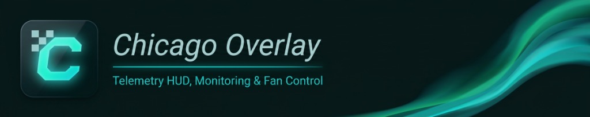
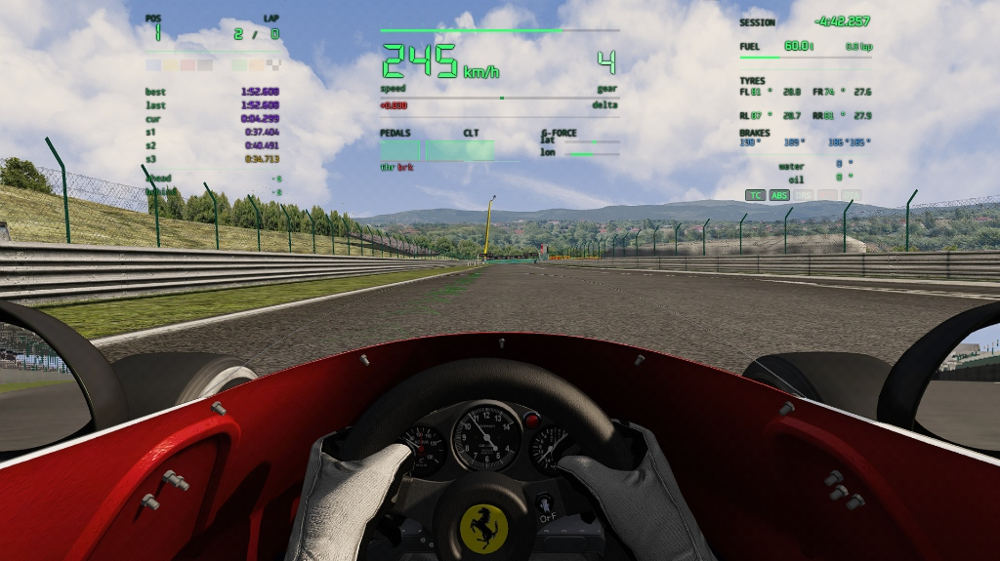
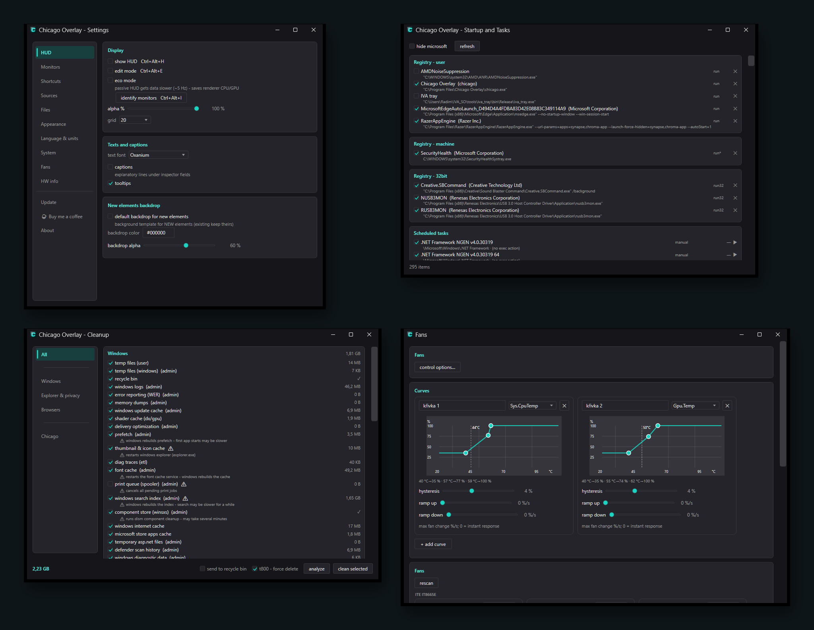
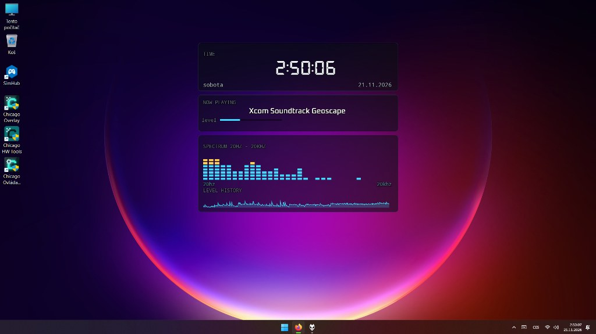
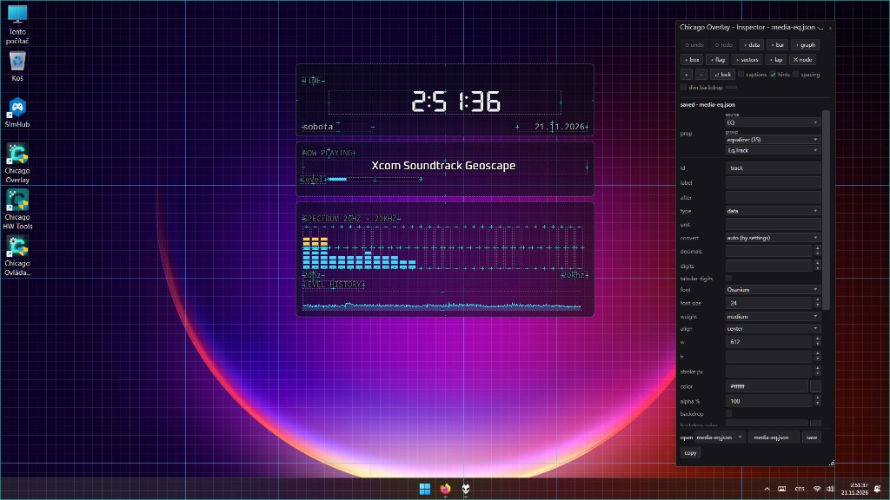
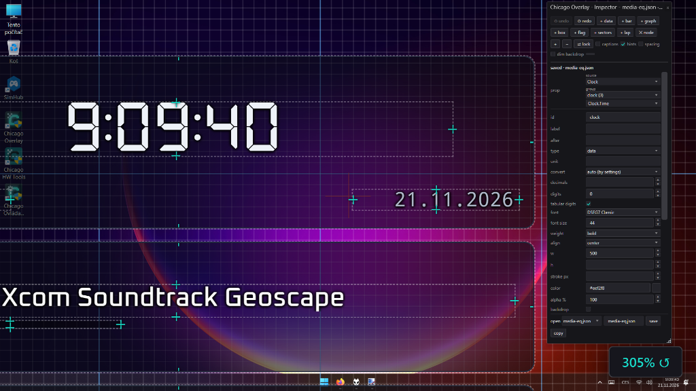
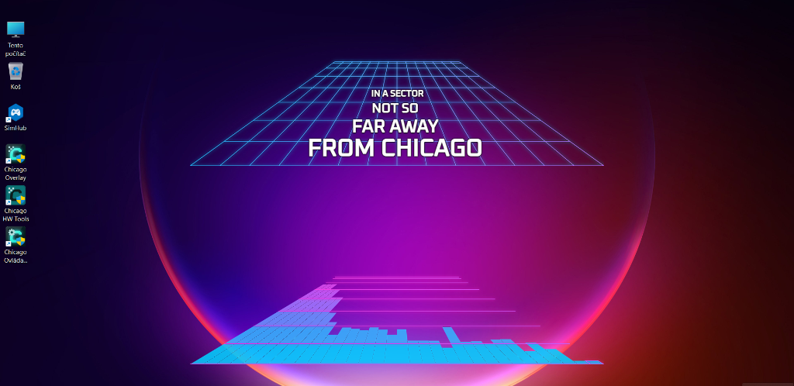

https://github.com/user-attachments/assets/f295d1df-57e7-49dc-af6d-08ef3f8c6a13

*▶ [1.5-Teaser-Video ansehen (mp4)](https://github.com/RadimSvatek/chicago-overlay/releases/download/v1.5.527/chicago1_5.mp4)*

*Seit Projekt Chicago fehlte Windows eine Ebene, die mehr ist als ein modisches Accessoire. Also habe ich sie verbunden.*

**Ein leichtgewichtiges, frei anpassbares Multi-Monitor-Telemetrie- und System-HUD-Overlay für Windows 10/11.**
Gebaut für Sim-Racing (über SimHub), PC-Hardware-Monitoring und sichere Lüftersteuerung auf Hardware-Ebene - aber eigentlich ist es die Ebene, die Windows nie hatte: ein visueller Widget-Baukasten für alles, was dein PC weiß. Drag-and-Drop-Layouteditor, 1.400+ Datenquellen, Texte, Balken, Graphen und Bilder überall auf jedem Bildschirm - null Code. Renn-HUD am Samstag, PC-Dashboard am Sonntag - dieselbe Engine, dein Layout.

**2.205 bindbare Props - 723 eingebaute + 1.482 aus der kompletten SimHub-Telemetrie. Zieh jeden per Drag-and-Drop-Editor auf deine Leinwand: HUD, Pille, Widget oder RTSS-Ingame-Overlay. Null Code, der Look ist zu 100% deine Fantasie.**

---

### Warum es anders ist

Die meisten Hardware- und Telemetrie-Tools enden bei einer passiven Tabelle im eigenen Fenster. Chicago Overlay geht weiter - vier Schichten, eine Datenengine:

- **Komplette HW-Diagnostik & Inventur** - Erkennung auf dem Niveau der Besten - like CPU-Z, GPU-Z oder HWiNFO, in einer sauberen durchsuchbaren Tabelle mit CSV-Export (723 eingebaute Props + 1.482 aus der SimHub-Telemetrie = **2.205 gesamt**).
- **Mehrere visuelle Ausgänge** - WebView-Canvas, natives WPF oder RTSS-Text. Jeder Wert aus der Tabelle geht direkt auf deinen Bildschirm, ins Spiel im exklusiven Vollbild oder auf den zweiten Monitor.
- **Zwei Bedienmodi** - Easy-Modus Pillen/Widgets: klicken, Skin und Werte wählen, mit der Maus ziehen - fertig in 10 Sekunden, ohne WebView2. Fortgeschrittener Inspektor (`Strg+Alt+E`): volle kreative Freiheit ohne Code - 25-800 % Zoom, 3D-Perspektivgrids, EQ, eigene Graphen, Ebenen, Clipboard-Sharing.
- **Ehrliche System-Tools obendrauf** - Lüfterkurven mit Guardian-Watchdog, CPU/GPU/RAM-Stresstest, der schnelle T800-Cleaner und Start-&-Tasks-Manager in einer einzigen leichten App.

---

### Hauptfunktionen

* **Universelle Telemetrie & Systemdaten:**
  * **Sim-Racing (SimHub Bridge):** Volle Unterstützung von 1.400+ SimHub-Properties (Tempo, Drehzahl, Gang, Live-Delta, Sektor- & Rundenzeiten mit automatischem Purple/Green/Yellow-Status, Gaps, Reifen-/Bremstemperaturen & -drücke, Sprit, Flaggen, Pedal-Graphen). Läuft den vollen lizenzierten 60-Hz-Tick mit Delta-Frames (nur geänderte Werte reisen über die Leitung), gecachte Accessoren und belegbare Lenkrad-Tastenaktionen - federleichte CPU-Last. Inklusive automatischer Plugin-Installation und Versionsprüfung.
  * **DirectX FPS & Frametimes:** Herstellerunabhängige FPS, Frametime-Graphen und CPU/GPU-Framezeiten per Intel PresentMon (läuft in Borderless & Vollbild).
  * **Hardware-Sensoren:** Echtzeit-CPU/GPU-Temperaturen, Leistungsaufnahme (W), Auslastung, RAM, Mainboard-Temperatursensoren und Lüfterdrehzahlen via LibreHardwareMonitor & signiertem PawnIO-Treiber.
  * **Netzwerk-Telemetrie:** Ping, Paketverlust % und Down-/Up-Durchsatz (kB/s) - mit konfigurierbaren Ping-Zielen (Adressliste in den Einstellungen, eigene ergänzen, per Hotkey durchschalten; `Net.Target` zeigt das aktive). Für Online-Rennen und Alltags-Monitoring; in Alarmregeln nutzbar („Paketverlust"-Sprachwarnung).
  * **Desktop & Medien:** Uhr, Datum und Echtzeit-Audiospektrum (8 wählbare EQ-Engines) mit Titelinfo.
* **Eingebauter visueller HUD-Builder (`Strg+Alt+E`):**
  * Drag-and-Drop-Platzierung, Mehrfachauswahl (Auswahlrahmen), einrastendes Raster mit konfigurierbaren Hauptlinien, bildschirmweites Fadenkreuz und Hintergrundabdunklung für entspanntes Bearbeiten.
  * Vielfältige visuelle Elemente: Datenfelder, Balken (einfarbig, Farbverlauf, HSL-Spektrum, LED-Segmente, Leuchteffekt, Spiegelung), Liniendiagramme, Flaggen, Sektoren, Rundenzeiten, Status-Boxen - und **Bildelemente** für Team-Logos, Channel-Branding, Badges oder jedes Bild - Pflicht, wenn dein HUD zugleich Stream-Overlay ist (Fit-Modi, Opazität, Hintergrund, Eckenradius, PNG-Transparenz).
  * Rechtsklick auf ein Element = **Ebenenreihenfolge** - ganz nach vorn / eins vor / eins zurück / ganz nach hinten funktioniert über alle Elementtypen, Gruppen bewegen sich als Block, voller Undo-Support.
  * **Intelligente bedingte Regeln:** 3-stufige Farbschwellenwerte, blinkende Warnungen und Sichtbarkeitsregeln (`<`, `<=`, `=`, `!=`, `>=`, `>`) ganz ohne Programmierkenntnisse.
* **Desktop-Widgets - die Ebene, die Windows nie hatte:**
  * Frei schwebende native Widgets (Pills), gezeichnet von der eingebauten WPF-Engine - **null WebView2, minimaler RAM-Verbrauch**. An jede Bildschirmkante andocken oder in den **Frei-Modus** schalten und mit pixelgenauem X/Y parken.
  * **Direkt auf dem Desktop greifen und ziehen** im Edit-Modus (`Strg+Alt+E`) - die Position speichert sich von selbst, Click-Through kehrt danach zurück.
  * Pro Widget: horizontale oder vertikale Ausrichtung, eigener Name (im Tray-Untermenü sichtbar), **fertige Theme-Presets** statt endloser Farbspielerei, Gesamt-Transparenz plus separates Hintergrund-Alpha und Eckenradius (standardmäßig Kapsel, `0` = eckig).
  * Jedes Widget ist eine Zeile (oder Spalte) Live-Werte mit eigenem Skin - FPS, Frametimes, CPU, RAM, GPU-Last & -Temperatur… je nach gewählter Quelle. Ein fertiges `start-widget` liegt ab der Erstinstallation bei, Widgets schalten sich direkt im Tray-Menü um, und ein eigenes Widget-Fenster verwaltet sie alle.
* **Render-Engine pro Monitor:**
  * `webview` oder `native` pro Anzeige wählbar - die native Engine zeichnet `data`- & `box`-Layoutknoten direkt in WPF, **ganz ohne WebView2-Prozess** auf diesem Bildschirm: weniger RAM, sofortiges Zeichnen und feste Ziffernslots, sodass Werte nie zittern. Ein Layout nur mit Pill startet WebView gar nicht - der Monitor läuft automatisch nativ, und `Strg+Alt+I` zeigt, welche Engine wo wirklich läuft.
* **RTSS-Ingame-OSD:**
  * Live-Text jedes Widgets in den **RivaTuner Statistics Server** Shared Memory streamen - Statistiken in exklusivem Vollbild, wo normale Overlays nicht hinkommen (live verifiziert mit RTSS 7.3.7).
* **LAN-Dashboard - dein HUD auf jedem Gerät:**
  * Die ganze Leinwand als Live-Webseite auf Handy, Tablet oder zweitem PC im selben Netz - gestreamt per WebSocket nur mit den Keys, die das Layout wirklich liest.
  * Optionaler PIN sperrt den Handshake (sonst HTTP 401), die Seite skaliert auf jeden Viewport, und "send UI too" erlaubt Layout-Bearbeitung direkt vom Handy.
* **RGB-Hintergrundbeleuchtung (Aura):**
  * Aura-Regeln pro Prop steuern Tastatur- und Soundkarten-LEDs - nativ, ohne externes Tool, oder via OpenRGB als eigenem Kanal. Backend-Wahl pro Gerät und Dedup sorgen dafür, dass sich zwei Kanäle nie um dieselbe Hardware streiten.
* **Intelligente Quellen-Überwachung - Häkchen = Erlaubnis, Lauf = Bedarf:**
  * Eine erlaubte Quelle läuft nicht mehr, nur weil die App offen ist. EQ, Uhr, HW-Monitoring und PresentMon starten nur solange sie etwas verbraucht (Layout, Widget, RTSS-Stream, Alarm, laufende Session, Lüftersteuerung, offenes HW-Fenster) - und stoppen, sobald sie keiner braucht. Idle-Tray-Icon = Idle-App.
  * **Chicago überwacht sich selbst:** `App.*`-Props zeigen eigene CPU, privaten & geteilten RAM, WebView-Prozesszahl und deren Kosten, Threads, Fensterzahlen und den Status jeder Quelle. Die Seite **Quellen** zeigt Live-Verbrauch und *warum* jede Quelle läuft oder ruht.
* **Auto-Profile (spielabhängiges HUD):**
  * Wechselt Layouts automatisch, wenn ein Spiel oder ein beliebiger Prozess startet - Renn-HUD beim Start, nach dem Beenden zurück zum aufgeräumten Desktop. Erkennung über Prozessname oder SimHub-Spielname (Teilübereinstimmung). Ein Profil kann auch ein Layout über das Basislayout legen (`ov:`) oder stattdessen ein Makro ausführen.
  * Pro Monitor oder für alle, plus „HUD aus"-Regeln - z. B. Rennlayout auf dem Hauptbildschirm, Seitenmonitore dunkel.
* **Die Brücke - ein Live-Kontrollraum:**
  * Ein natives Konsolenfenster, das die gesamte Verdrahtung der App als Live-Karte zeichnet: Node-Regeln, Auras, Alerts, Profile, Bindings, Makros und Aktionen - mit echten Werten auf den Kanten und leuchtenden aktiven Zweigen.
  * Kill-Switches pro Regel, Aktions-/Makro-Trigger, ein Schieberegler der jeden Prop live steuert, und ein Test-Injektor (`prop=wert` für N Frames) - debugge deine HUD-Logik ohne die Konsole zu verlassen. Tray-Menü oder `/bridge`.
* **Bartender - serviere Layouts wie Drinks:**
  * Wähl einen Monitor (den „Tisch"), klick eine Karte, und das Layout wird über den normalen Profilpfad eingeschenkt - die manuelle Bar neben den automatischen Profilen. Widgets und Button-Grids können eigene Serve-Slots tragen, die dorthin einschenken, wo sie sitzen.
  * Das Tray-Menü ist auch ein Tisch: Serviere ihm ein Layout und seine Daten-Nodes rendern als Live-Wertzeilen (Temps, Ping, FPS), Button-Nodes werden klickbare Menüeinträge.
  * Drinks lassen sich mischen („mix with" verschmilzt zwei Layouts), markierte Drinks rotieren in einer Playlist alle N Sekunden über angehakte Tische, und jeder Drink packt sich als portables `.cpk` (Layout + alle Bild-Assets) für den Umzug zwischen Maschinen.
* **Windows-Tweaks als bindbare Props:**
  * Die **Windows-Seite** im Control Center ändert den OS-Look direkt aus der App - Taskleisten-Ausrichtung, Dark Theme, Dateiendungen, Scrollbar-Größe, klassisches Kontextmenü, Sekunden in der Uhr, Copilot & Vorschläge aus, volle Bildschirmschoner-Kontrolle und mehr. Jeder Tweak ist ein `Win.*`-Prop - bindbar in Layouts, Widgets und Makros wie Telemetrie, mit Backup vor dem ersten Schreiben und Undo per Klick.
  * Die Fenster `wininfo` / `winmaxi` sind das hwinfo/hwmaxi-Paar für Windows: kompakter Live-Reader und vollständiger Tweak-Katalog-Editor (`/wininfo`, `/winmaxi`).
* **Eigene, berechnete & abgeleitete Props:**
  * Füg eigene hinzu: `data\props\*.json` merged permanente Keys in jeden Frame, `data\calc\*.json` wertet Ausdrücke über Live-Werte pro Frame aus (z. B. `Calc.FuelDelta`) - alles erscheint sofort im Katalog und den Pickern.
  * **Abgeleitete Props** hängen ein Suffix an jeden numerischen Prop: `.avg` / `.min` / `.max` / `.rate` berechnet eine gleitende 10-s-Statistik (`Sys.Ram.avg`, `Gpu.Temp.max`, `Net.Ping.rate`) - überall bindbar wie ein Prop.
  * **PropManager** (`/props`) verwaltet den ganzen Katalog - Builtin/SimHub/Custom/Calc-Tabs, Live-Frame-Werte, Suche und Rechtsklick-Bearbeiten/Umbenennen/Löschen eigener Einträge ohne Neustart.
* **Schiffs-Look - Skins, Sektionen & Bildschirmschoner:**
  * App-weite Skins (Classic, Wave, Aurora…) plus Farben pro Sektion - die Brücke, Lüfter, Cleaner und jede Sektion trägt ihren eigenen Farbton, und der Skin-Editor lässt dich jede einzeln umfärben (ein blanker Akzent reicht, die Palette leitet sich ab).
  * Layout-Bildschirmschoner pro Monitor (`saver`, `saver-stars`, `saver-dmg` liegen bei) mit OSD-Kontrolldeck: `Strg+Alt` halten zeigt pro Monitor Karten für Layout- & Engine-Wechsel, Edit, Saver und Burn-Test.
* **Lüftersteuerung (sicher, auf Hardware-Ebene):**
  * Steuerung der Mainboard-Lüfter-Header (SuperIO-Chip über PawnIO), GPU-Lüfter und USB-Lüftercontroller - Auto / manuell % / Temperaturkurve.
  * Kurven mit 2-6 Ankern und Hysterese pro Kurve; Lüfter-Identifikation dreht einen Kanal auf 100 %, damit du erkennst, welcher Header welcher ist.
  * **Tray-Temperatur-Icons:** jede Lüfter-Temperaturquelle kann als transparentes Icon mit Live-Wert im Tray leben - LED-„Segment"-Ziffern (Standard) oder klassische Mono-Schrift, Akzent oder eigene Farbe pro Lüfter.
  * Eigenes **Lüfter-Fenster** aus dem Tray-Menü, plus eingebaute Warnungen bei fehlenden Adminrechten und Konflikten mit anderer Lüftersoftware.
  * Sicherheit eingebaut: 20%-Minimum, sofortige Rückkehr zu Hardware-Auto bei kritischen Temperaturen und ein Guardian-Watchdog-Prozess, der die Steuerung selbst bei einem App-Absturz zurücksetzt.
* **Tasten- & Tastenfeld-Belegung (lenkrad/button-box-freundlich):**
  * Belege jede Tastaturtaste oder Lenkrad-/Button-Box-Taste (bis zu 16 Geräte × 32 Tasten) auf der eigenen Shortcuts-Seite - Layoutwechsel, HUD an/aus, Edit-Modus, Monitore identifizieren, Lüfter an/aus oder Stresstest starten.
  * Funktioniert im Spiel; Layoutwechsel bietet Monitorwahl und optionale Sprachansage des Layoutnamens - praktisch für VR.
* **HW-Info - dein PC auf einen Blick:**
  * Windows-Version, BIOS, Mainboard, CPU (Kerne/Sockel/Takt), GPU (VRAM/Treiber), RAM-Module und Festplatten mit Kapazität - im Tray-Fenster, auf einer Einstellungsseite und im mitgelieferten `hw-info`-Layout. Komplette PC-Übersicht auf einen Blick.
* **Session-Reports & eingebauter Stresstest:**
  * Nach jeder Gaming-Session wird eine Zusammenfassung gespeichert (FPS-Schnitt, 1 %-Low, max. CPU/GPU-Temps & -Leistung, Dauer) - im eigenen Sessions-Fenster stöbern (Tray-Menü oder Einstellungen), unerwünschte Apps löschen oder ignorieren.
  * Eingebauter CPU- (0-100 % auf allen Kernen), GPU- (WebGL-Shader) und RAM-Stresstest (MB-Allokation) - perfekt zum Tunen von Lüfterkurven und dem `tune-lab`-Layout ohne externe Tools.
* **Warnungen & Bottleneck-Erkennung:**
  * Regeln „Schlüssel >= / <= Wert" über beliebiger Telemetrie mit Piep oder Windows-Sprachansage (mit Pause zwischen Wiederholungen).
  * `Sys.Limit` / `Sys.Throttle` zeigen, was deine FPS bremst - GPU, CPU oder Thermo-Throttle.
* **System-Bereinigung mit T800-Modus:**
  * Tiefenreinigung für Windows- und Browserdaten per Klick: Temp-Dateien, Logs, Caches, Delivery Optimization, WinSxS-Komponenten (DISM), Font- & Thumbnail-Caches, Update-Reste, Defender- & Diagnosehistorie und mehr - jeder Eintrag nach Risikostufe markiert (sicher / gefährlich / Privatsphäre / Benutzerdaten).
  * Der optionale **T800-Modus** löscht auch gesperrte Dateien: er beendet die Prozesse, die sie halten - schützt dabei sich selbst, seine Kindprozesse und alles systemkritisch Markierte - und plant die Härtefälle fürs Löschen beim nächsten Boot. Die stille Bereinigung läuft auch aus dem Kontextmenü des Papierkorbs.
* **Autostart- & Aufgaben-Manager:**
  * Alles, was mit dem PC startet, in einem Fenster - Registry-Run-Keys, Autostart-Ordner, Dienste und alle geplanten Aufgaben (Triggertyp, nächster & letzter Lauf, Jetzt ausführen, Deaktivieren und Löschen für Nicht-Systemeinträge).
* **Kommandozeilen-Steuerung (`/help`):**
  * Eine exe, viele Schalter (`/x`, `-x` oder `--x`): direkt in jedes Fenster springen (`/settings`, `/widgets`, `/cleaner`, `/startup`, `/fans`, `/hwinfo` …), Modus wählen (`/tools`, `/lite`, `/full`), stille Bereinigung (`/clean`, `/clean-bin`) oder Startzustand setzen, ohne Einstellungen zu schreiben (`/debug`, `/applog`, `/source`, `/lang`, `/scale`, `/layout`).
  * Der Installer legt optional ein **„Chicago Control Center"**-Desktop-Icon an, das das Kontrollzentrum direkt öffnet (`/settings`) - praktisch, falls das Tray-Icon mal unerreichbar ist. Shortcut kopieren, Parameter ändern, beliebiges Fenster an den Desktop pinnen.
* **Chicago Werkzeuge - eigener PC-Tuning-Modus:**
  * Kein Racing? Nutze Chicago als schlankes PC-Tuning-Werkzeug: Lüftersteuerung mit Kurven, Tray-Temperatur-Icons, HW-Info, Live-Ping/Verluste, Stresstest, Session-Reports, System-Bereinigung und Warnungen - mit Overlay, SimHub-Plugin und WebView2 komplett aus.
  * Installiert als optionale Komponente mit eigenem **„Chicago Werkzeuge"**-Shortcut und Icon - oder jederzeit per `chicago.exe --tools`. Die Haupt-App läuft ebenfalls schlank mit `/lite`.
* **Echte Multi-Monitor-Unterstützung & geringer RAM-Verbrauch:**
  * Jedem Monitor lassen sich ein eigenes Layout sowie eine unabhängige Bildwiederholrate (Volle Geschwindigkeit / 60 / 30 / 20 / 10 / 5 Hz) zuweisen.
  * Wahl zwischen **Shared Canvas** (ein einziger WebView2-Renderer für alle Monitore - spart ca. 140 MB RAM pro zusätzlichem Bildschirm) oder **Split Canvas**.
  * Auf fast null CPU-Kosten getrimmt: Hardware-Init und Rescans laufen im Hintergrund, Telemetrie fährt auf Delta-Frames und Leerlaufarbeit ist geblockt - das Overlay bleibt flott und unsichtbar, bis es etwas zu zeigen hat.
* **28 einsatzbereite Vorlagen enthalten:**
  * Enthält `start`, `race-minimal`, `race-hud`, `race-pro`, `race-pro-2`, `race-hw`, `system-hw`, `system-hud`, `hw-info`, `maxi-hw`, `media-eq`, `media-hud`, `media-hud-2`, `combo-desk`, `combo-hud`, `tune-lab` (Lüfterkurven- & Stress-Tuning), `flat-stage`, `persp-stage`, `crawl-stage`, `pill-hw` (Native-Widget-Demo), `ring-lab`, `fx-lab`, `demo-scene`, `rig-desk` (dein Rig-Foto mit Live-Dioden), `sci-fi` und drei Bildschirmschoner-Layouts (`saver`, `saver-stars`, `saver-dmg`).
* **8 Sprachen & natives Windows-11/10-Design:**
  * Verfügbar auf **Deutsch, Englisch, Tschechisch, Spanisch, Französisch, Italienisch, Polnisch und Russisch** (sowohl Installer als auch App). Übernimmt automatisch die Windows-Akzentfarbe sowie den Dunkel-/Hellmodus - oder wähle einen eigenen Akzent; die Markenfarbe Teal `#18D4C2` ist auf Neuinstallationen vorgewählt (deine Wahl wird nie überschrieben).

---

### Full oder Werkzeuge - Wahl bei der Installation

Ein Installer, zwei Editionen. Du wählst direkt nach der Infoseite - und kannst die andere Edition später jederzeit starten, beide leben nebeneinander.

|| **Full** | **Werkzeuge** |
|---|:---:|:---:|
| HUD-Overlay, Layouts & visueller Editor | ✓ | - |
| SimHub-Renntelemetrie | ✓ | - |
| Widgets & Medien auf der Leinwand | ✓ | - |
| FPS & Frametimes (PresentMon) | ✓ | ✓ |
| Lüftersteuerung, Kurven & Guardian-Watchdog | ✓ | ✓ |
| HW-Info, Sensoren & Netzwerk-Monitoring | ✓ | ✓ |
| Stresstest, Session-Reports & Warnungen | ✓ | ✓ |
| System-Bereinigung & Autostart-/Aufgaben-Manager | ✓ | ✓ |
| Einstellungen, Updates, Autostart, 8 Sprachen | ✓ | ✓ |
| RGB-Aura, LED-Matrizen & Tastatur als Canvas | ✓ | ✓ |
| EQ-Spektrum & Media-Props auf RGB/LED-Ausgaben | ✓ | ✓ |
| Datenbus: MQTT, HTTP/JSON, Webhooks, HWiNFO SM | ✓ | ✓ |
| Eigene & berechnete Props, AI-Datenlink | ✓ | ✓ |
| WebView2-Runtime | im Paket | nicht nötig |

*Beide Editionen bekommen einen eigenen Startmenü-Shortcut (Desktop optional). Werkzeuge ist dieselbe `chicago.exe` im dedizierten `--tools`-Modus - kein Overlay, kein SimHub, minimaler RAM.*

---

### Schnellstart

1. **Installieren:** `chicago overlay setup <ver>.exe` ausführen (~70 MB, inklusive .NET-8- & WebView2-Voraussetzungen). Der Installer erkennt `.NET 8` / `WebView2` automatisch und installiert das `Chicago.Bridge.dll`-Plugin direkt in deinen SimHub-Ordner.
2. **In SimHub aktivieren:** SimHub öffnen und das **Chicago-Overlay**-Plugin aktivieren, wenn du gefragt wirst (oder den Ein-Klick-Installer/Updater im Tray-Menü der App bzw. unter *Einstellungen → Quellen* nutzen).
3. **Anpassen:** **`Strg+Alt+E`** jederzeit für den **Edit-Modus** und den Inspektor drücken. **`Strg+Alt+H`** schaltet die HUD-Sichtbarkeit um, **`Strg+Alt+I`** identifiziert deine Monitore.

---

### Download

Hol dir das neueste `chicago_overlay_<ver>.zip` aus den **[Releases](../../releases)**, entpacke es und starte das Setup darin (.NET-8- & WebView2-Voraussetzungen sind gebündelt). Der eingebaute Update-Checker meldet neue Versionen. Jedes Release veröffentlicht den SHA-256 des Setups und einen [VirusTotal](https://www.virustotal.com/)-Link - falls SmartScreen vor unsignierter Freeware warnt, lässt sich die Datei mit einem Klick prüfen.

---

### Hinter dem Projekt (Ein Wort vom Autor)

Chicago Overlay entstand nicht in einem modernen Großraumbüro - geschrieben und getestet wurde es in einem **Wohnwagenwerk-Wohnwagen von 1984**, der mein Zuhause ist. Irgendwie passt das zum Motorsport: 1984 war die goldene Ära der Formel 1, als Fahrer und Ingenieure direkt aus ihren Wohnwagen im Fahrerlager lebten und arbeiteten.

Weil ich in einer ländlichen Gegend mit begrenzten Jobchancen wohne, wurde dieses Projekt mein Weg, jahrzehntelanges PC-Handwerk der alten Schule einzusetzen - mit Fokus auf sauberes Engineering, null stille Fehler und Respekt vor jedem Megabyte RAM und jedem FPS.

**Dein Feedback treibt voran, was als Nächstes kommt:**
Jede Idee, jeder Bugreport, jedes geteilte Layout oder jeder Vorschlag aus der Community ist wirklich willkommen. Wenn das Projekt bei dir ankommt, entwickle ich es gern weiter und biete direkten, individuellen Support für Nutzer und Sim-Racing-Teams.

Wenn dir Chicago Overlay Freude macht und du die weitere Entwicklung unterstützen möchtest (oder mir einfach in einer schwierigen Lebenslage helfen willst), bedeutet jeder freiwillige Beitrag mir die Welt - als Anerkennung der Arbeit und als echte, praktische Hilfe:

**[Unterstützen auf Ko-fi (Karte / Apple Pay / Google Pay / PayPal)](https://ko-fi.com/radimsvatek)**

*P.S. Das Projekt steht immer noch bei 0 Sternen - wenn Chicago deinen PC etwas schöner macht, kostet ein ⭐ nichts und hilft wirklich, es überhaupt zu finden.*

Danke fürs Ausprobieren - wir sehen uns auf der Strecke!

---

### Lizenz & Vertrieb

* **Anwendung (`Chicago Overlay`):** **Donationware / Freeware** - komplett kostenlos zum Download und zur Nutzung, ohne gesperrte Funktionen oder Abos. Wenn sie dir nützt, ist jeder freiwillige Beitrag über [Ko-fi](https://ko-fi.com/radimsvatek) sehr willkommen. Weitergabe modifizierter Binärdateien oder kommerzieller Weiterverkauf ohne Erlaubnis ist nicht gestattet.
* **Quellcode:** nicht öffentlich - bleibt privat beim Autor. Jede Verwendung des Codes in anderen Projekten oder Produkten erfordert die Erlaubnis des Autors.
* **Layouts & Sprachpakete (`.json`):** frei nutzbar, veränderbar und in der Community teilbar.
* **Gewährleistung:** die Software wird „wie besehen" ohne jegliche Gewährleistung bereitgestellt. Nutzung auf eigene Gefahr.

---

### Galerie

