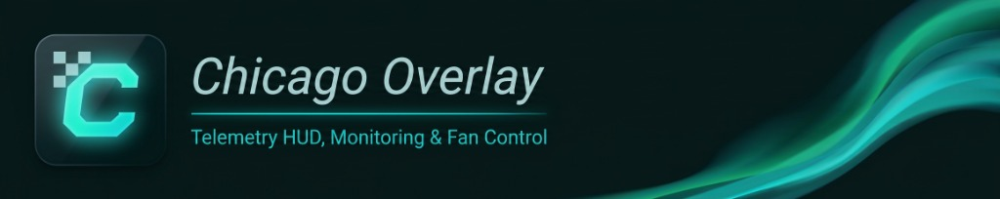
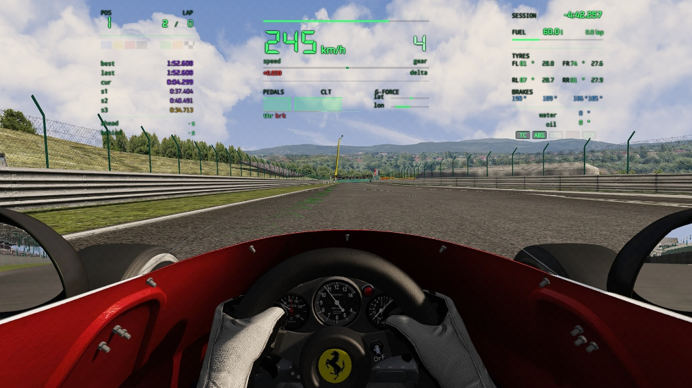
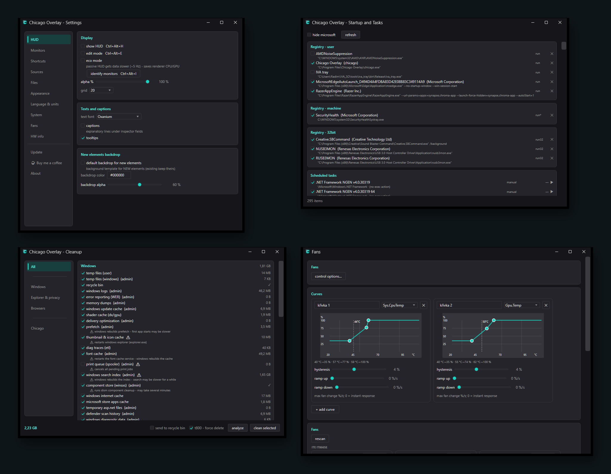
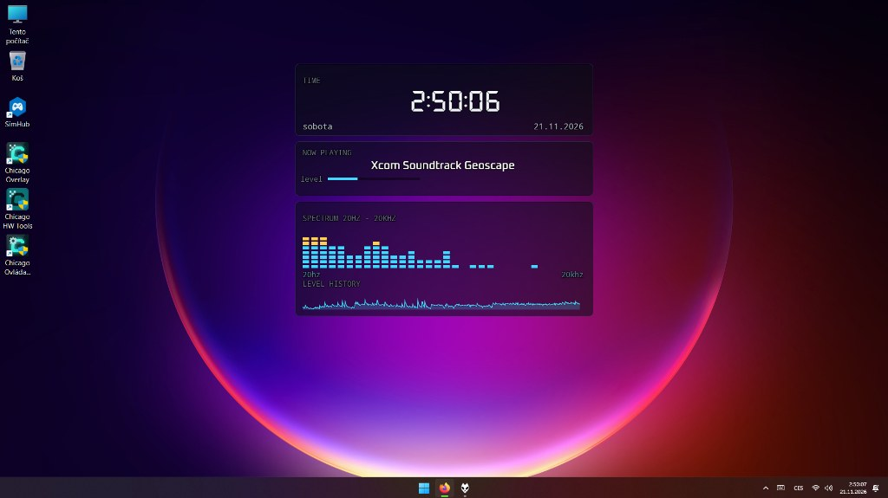
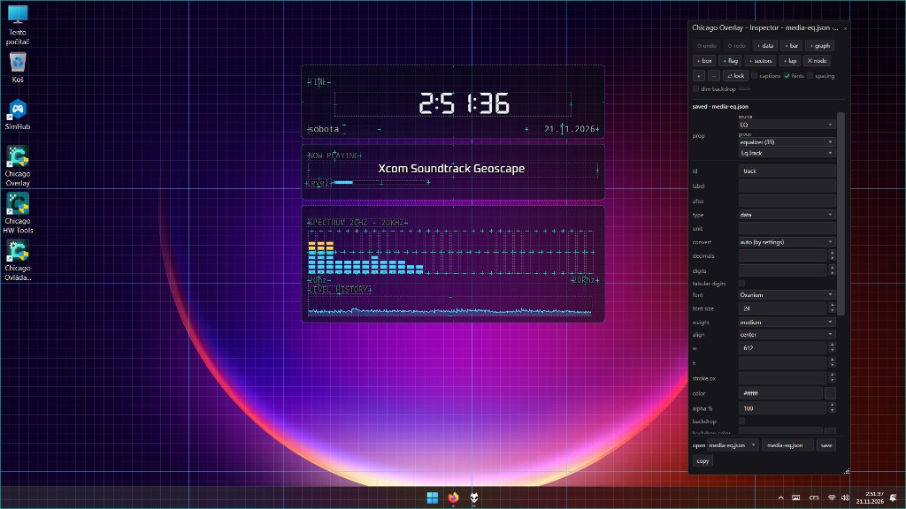
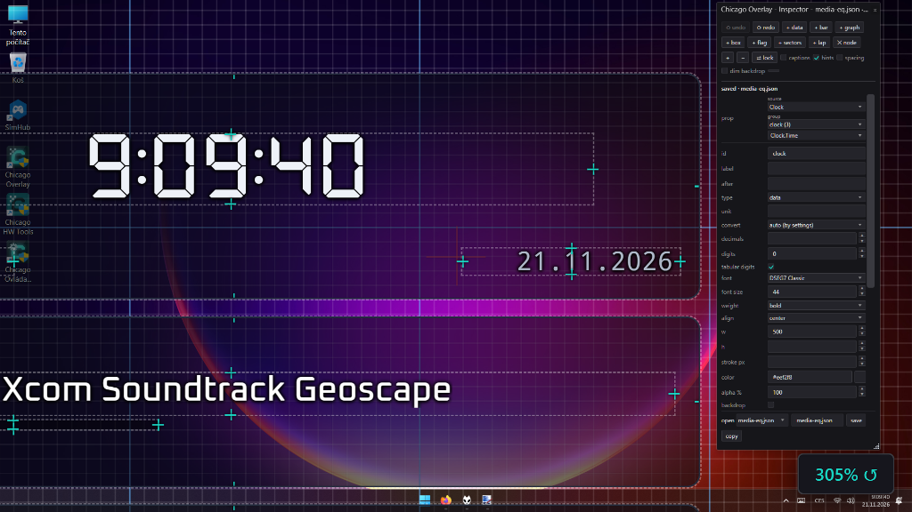
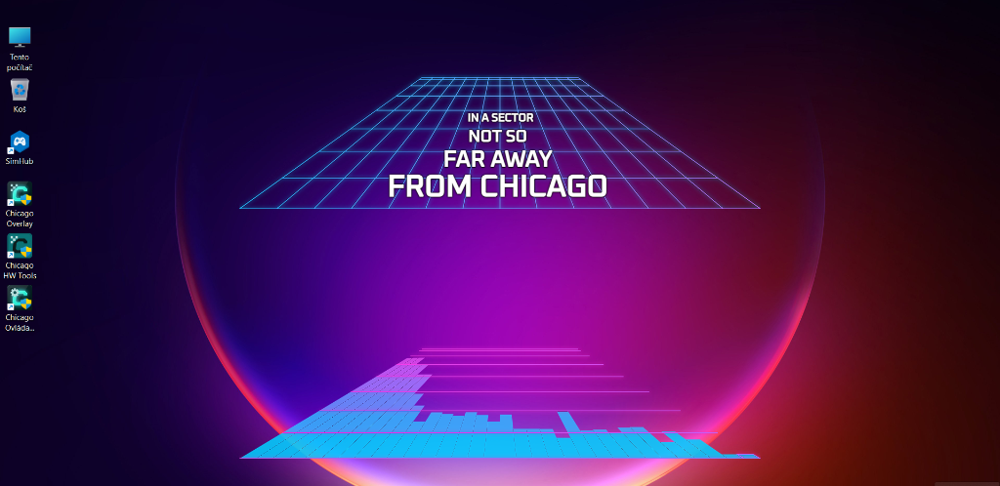

https://github.com/user-attachments/assets/f295d1df-57e7-49dc-af6d-08ef3f8c6a13

*▶ [Watch the 1.5 teaser video (mp4)](https://github.com/RadimSvatek/chicago-overlay/releases/download/v1.5.527/chicago1_5.mp4)*

*Since Project Chicago, Windows was missing a layer that is more than a fashion accessory. So I wired it up.*

**A lightweight, customizable, multi-monitor telemetry & system HUD overlay for Windows 10/11.**
*Windows 10 is no longer supported by Microsoft. Chicago Overlay should still run, but this configuration is not tested and not guaranteed.*
Built for sim racing (via SimHub), PC hardware monitoring, and safe hardware-level fan control - but really, it is the layer Windows never shipped: a visual widget builder for anything your PC knows. Drag-and-drop layout editor, 1,600+ data sources, text, bars, graphs and images anywhere on any screen - zero code. Race HUD on Saturday, PC dashboard on Sunday - the same engine, your layout.

**2,512 bindable props - 845 built-in + 1,667 from the full SimHub telemetry feed. Drag any of them onto your canvas with the drag-and-drop editor: HUD, pill, widget or RTSS in-game overlay. Zero code, the look is 100% your imagination.**

---

### Why it is different

Most hardware and telemetry tools end at a passive table inside their own window. Chicago Overlay keeps going - four layers, one data engine:

- **Complete HW diagnostics & inventory** - detection on par with the best - like CPU-Z, GPU-Z or HWiNFO, in a clean searchable table with CSV export (845 built-in props + 1,667 from the SimHub telemetry feed = **2,512 total**).
- **Multiple visual outputs** - WebView canvas, native WPF, or RTSS text. Any value from that table goes straight onto your screen, into a game in exclusive fullscreen, or to a second monitor.
- **Two control modes** - Easy mode pills/widgets: click, pick a skin and values, drag with the mouse - done in 10 seconds, no WebView2. Advanced Inspector (`Ctrl+Alt+E`): full creative freedom without code - 25-800 % zoom, 3D perspective grids, EQ, custom graphs, layers, clipboard sharing.
- **Honest system tools on top** - fan curves with a guardian watchdog, CPU/GPU/RAM stress test, the fast T800 cleaner and Start & Tasks manager in a single lightweight app.

---

### Key Features

* **Universal Telemetry & System Data:**
  * **Sim Racing (SimHub Bridge):** Full support for 1,600+ SimHub properties (speed, RPM, gear, live delta, sector & lap times with automatic purple/green/yellow status colors, gaps, tyre/brake temperatures & pressures, fuel, flags, pedal graphs). Runs the full licensed 60 Hz tick with delta frames (only changed values travel the wire), cached accessors and bindable wheel-button actions - feather-light CPU cost. Includes automatic plugin installation and version checks. **Remote engineer mode:** the plugin takes an app host - the driver runs SimHub on their PC, the race engineer enables LAN bind on their side and the telemetry flows over the network straight into their Chicago instance.
  * **DirectX FPS & Frametimes:** Vendor-agnostic FPS, frametime graphs, and CPU/GPU frame times powered by Intel PresentMon (works in borderless & fullscreen).
  * **Hardware Sensors:** Real-time CPU/GPU temperatures, power draw (W), usage, RAM, motherboard temperature sensors and fan RPMs via LibreHardwareMonitor & signed PawnIO driver.
  * **Network Telemetry:** ping, packet loss %, and down/up throughput (kB/s) - with configurable ping targets (address list in Settings, add your own, cycle them via a shortcut; `Net.Target` shows the active one). For online racing and everyday monitoring; usable in alert rules ("packet loss" voice warning).
  * **Desktop & Media:** Clock, date, and real-time audio spectrum visualizer (8 selectable EQ engines) with current track info.
* **Map - build your own ship (new control concept):**
  * Every component of the app - every settings page, every data channel - lives as a **module on a free canvas** you arrange yourself. Assemble your own ship like a station: drag modules anywhere, give each its own size, custom image or even its own font, and set a custom map background. No fixed menu layout - your arrangement IS the interface, memorable because you built it.
  * **Winamp-style magnetizing:** module edges snap to each other as you drag, and modules touching edge-to-edge link with a visible joint - your connected components literally dock together.
  * Right-click any module for **properties**: size, custom image, custom font - and on hardware components a **run-as-administrator flag** so admin rights apply only where actually needed, never dragging down WebView2 elsewhere.
  * Map settings live behind one button: background grid on/off, edge magnetizing, default module size, custom background image, layout reset. **Fullscreen mode (F11)** turns the map into a dedicated control surface. The installer puts a "Chicago Map" shortcut on the desktop and in Start - or run `chicago.exe /map`.
  * 📖 **[The Map Cheat Sheet & Theme Ideas](MAP.md)** - spatial memory tricks, per-module security and theme builds (ISS, floorplan, talent tree, Winamp rack).

* **Open data channels - the ship talks to your whole house (experimental):**
  * Every channel is a JSON file in `data\` - the app reads it, spawns the source, and its values land on the same prop bus as telemetry: bindable to layouts, widgets, auras, alerts and macros with zero code. Everything is demand-gated - a channel runs only while something actually reads it.
  * **Smart home & IoT:** MQTT subscribe (topics with wildcards, JSON payloads flatten into props) + `mqtt:pub` back channel; Home Assistant over its websocket API (live `state_changed` push + `ha:` service calls back); a universal HTTP/JSON poller with custom headers (Bearer/API keys, DPAPI-encrypted secrets) and `http:post` write-back.
  * **Network:** routers over UPnP/SNMP plus native REST for MikroTik, OpenWrt, UniFi and ASUSWrt (WAN ip/up/mbps, clients, uptime), ping watchlists, LAN client counts, ping sweep, top-talking client and `Net.TopApp` per-process traffic.
  * **Apps & games:** OBS WebSocket 5.x telemetry (stream/rec/scene/bitrate/mute) + `obs:` scene/stream/rec/mute control, Plex now-playing, Elite Dangerous journal telemetry, Windows media sessions (title/artist/playing/progress), a local music player (`music:*` actions, `Music.*` props) and a Klipper/Moonraker 3D-printer channel.
  * **Webhooks & streams:** a loopback-only JSON listener (`hooks.json`) for game-push telemetry (GSI-style) and scripts, a UDP/serial raw stream out to ESP32/OLED gear, file-based pollers for your own scripts' JSON, and a remote channel that mirrors another Chicago instance's props over the LAN.
  * **Voice, fully offline:** built-in Windows speech recognition - push-to-talk or dictation, `voice.json` maps phrases to any action, `voice:say` answers through modern WinRT voices. Hear-decide-act on your own hardware, no cloud key.
  * **Made for AI agents:** a loopback "live link" (`GET /props`, `GET /status`, `POST /obj`), one-click `AGENTS.md` + live context export to the clipboard, `ai-status.json` collecting every broken config with its error, and hot-reload - an agent edits `data\` files and the canvas repaints within ~400 ms.
  * The **Channels window** (`/channels`, also in CC > Sources) lists every channel with its live status and errors, and each channel editor is its own module (`/chcfg:<id>`): JSON validation while typing, atomic saves, schema hints and one-click templates.
  * The **Source Manager** (`/srcman`, tray > Sources, CC > Sources, a module-map tile) draws the whole wiring as a live data-flow map: every source on the left, the props engine in the middle, outputs on the right (live link, LAN dashboard, LED/aura, stream sinks). Wires light up with activity, each node carries its run reason and prop count, clicking it toggles the channel or edits host/port/url straight from its JSON - and node positions drag and persist.
  * The **fan guardian** can run as a Windows service (ChicagoGuardian under SYSTEM) - watching fans and RGB from boot, surviving sign-out and restoring hardware even if the app crashes.
* **Built-in Visual HUD Builder (`Ctrl+Alt+E`):**
  * Drag-and-drop placement, multi-select marquee, snapping grid with configurable major lines, screen-wide crosshairs, and background dimming scrim for easy editing.
  * Rich visual elements: data readouts, bars (solid, gradient, HSL spectrum, LED segments, glow, reflection), line graphs, flags, sectors, lap times, status boxes - and **image elements** for team logos, channel branding, badges or any picture - a must-have when your HUD doubles as a stream overlay (fit modes, opacity, background, corner radius, PNG transparency) - plus **needle elements**: any transparent PNG rotates around a custom pivot driven by a prop - steering wheel beyond 360 deg, RPM/speed needles on a self-made dash - with exponential smoothing and a resting angle when data is missing.
  * Right-click any element for **layer ordering** - to front / forward / backward / to back works across every element type, groups move as a block, full undo support.
  * **Smart Conditional Rules:** 3-level color thresholds, blinking alerts, and visibility rules (`<`, `<=`, `=`, `!=`, `>=`, `>`) without touching a single line of code.
* **Desktop Widgets - the layer Windows never shipped:**
  * Free-floating native widgets (pills) drawn by a built-in WPF engine - **zero WebView2, near-zero RAM**. Snap them to any screen edge, or flip to **free mode** and park them anywhere with pixel-precise X/Y.
  * **Grab and drag them right on the desktop** in Edit mode (`Ctrl+Alt+E`) - the position saves itself and click-through comes back the moment you're done.
  * Per widget: horizontal or vertical orientation, custom name (shown in the tray submenu), **theme presets** instead of endless color fiddling, overall transparency plus a separate background alpha, and corner radius (capsule pill by default, `0` = sharp box).
  * Every widget is a row (or column) of live values with its own skin - FPS, frametimes, CPU, RAM, GPU load & temp… whatever source you pick. A ready-made `start-widget` ships on first install, widgets toggle straight from the tray menu, and a standalone Widgets window manages them all.
* **HUD in a window - any layout as a standalone window:**
  * Tray menu "Window" turns a layout into a normal window, fully decoupled from monitor assignment - "new" spawns extra instances, so several windows can run at once (even the same layout twice). A layout can live on the HUD surface and in a window at the same time.
  * The title bar carries window-opacity and canvas-zoom sliders, title / fullscreen F11 / maximize toggles and a layout dropdown that swaps the window's content in place; right-click on the canvas opens the window menu (always on top, sliders, inspector, close). Buttons respond to direct clicks in the windowed render.
  * Window state (position, size, opacity, zoom, background) persists in the layout's `win` section and survives restart and `.cpk` export.
* **Render engine per monitor:**
  * Pick `webview` or `native` per display - the native engine paints `data` & `box` layout nodes directly in WPF with **no WebView2 process at all** on that screen: less RAM, instant paint, and fixed-width digit slots so values never jitter. A layout holding only a pill never starts WebView at all - the monitor runs native automatically, and `Ctrl+Alt+I` shows which engine each screen actually uses.
* **RTSS in-game OSD:**
  * Stream any widget's live text into **RivaTuner Statistics Server** shared memory - your stats inside exclusive-fullscreen games where ordinary overlays can't reach (verified live on RTSS 7.3.7).
* **Dashboards - tiles on a grid:**
  * `dash:*` profiles compile tiles into HUD layouts - a Dashboard page in Settings manages profiles, the canvas (columns, gaps, tile height, width) and per-type tile forms (big-value, chart, list, card, server-card, serve); every change repaints an open window in ~400 ms. Tray menu carries quick profile access.
  * Dash cards carry a `rows[]`/`cells[]` schema - labels, values, sparklines, charts, bars, pills, lists and buttons inside one tile, sections get a colored tab, `tpl:*` templates ship ready.
  * Edit mode works in **two levels** - tiles as bricks (drag snapping to the grid on both axes, a resize grip in the corner, span/height/pin toolbar) and a real inspector on the elements *inside* each tile: click or drag them within the tile bounds, positions save relative to the tile so it stays one movable brick.
* **Modules as atoms, packs & a composable tray:**
  * The **Component manager** toggles each of the 16 app atoms individually - a disabled module goes fully offline (as if uninstalled) with an activation prompt to bring it back, quarter presets flip common bundles, and windows deeplink straight to it.
  * **Content packs** - a catalog in the Manager installs / removes / seeds layout packs; four bundled `.cpk` packs ship inside the installer.
  * The **tray menu is a tree** - the whole top level is user-composable (`tray.items`), with custom `grp.N` groups nested arbitrarily deep, `sep.N` separators and an editable Tools subtree.
  * **Splash screen at startup** - a rounded frame with the logo, a live startup-step list and a configurable progress gradient (custom hex pair or "follow Windows accent"); toggled in Settings -> System.
* **LAN Dashboard - your HUD on any device:**
  * The whole canvas as a live web page on your phone, tablet or a second PC on the same network - streamed over WebSocket carrying only the keys the layout actually reads.
  * Optional PIN locks the handshake (HTTP 401 without it), the page scale-fits to any viewport, and "send UI too" lets you edit layouts right from the phone.
* **RGB Backlight (Aura):**
  * Per-prop aura rules light up keyboard and sound-card LEDs - natively, no external tool needed, or via OpenRGB as a separate channel. Per-device backend choice and dedup mean two channels never fight over the same hardware.
* **Smart Resource Supervision - checkbox = permission, run = demand:**
  * An enabled source no longer runs just because the app is open. EQ, clock, hardware monitoring and PresentMon start only while something actually consumes them (a layout, widget, RTSS stream, alert rule, live session, fan control, an open HW window) - and stop the moment nobody needs them. Idle tray icon = idle app.
  * **Chicago audits itself:** `App.*` props expose its own CPU, private & shared RAM, WebView child count and their cost, threads, window counts and every source's state - plus install/data/brand paths and the app version for text & web nodes (`app:` brand assets included). The **Sources page** shows live usage plus *why* each source runs or idles.
* **Auto Profiles (game-aware HUD):**
  * Switch layouts automatically when a game or any process starts - race HUD on launch, back to a clean desktop on exit. Detection via process name or SimHub game name (partial match). A profile can also overlay a layout on top of the base one (`ov:`), or run a macro instead.
  * Per-monitor or all monitors, plus "HUD off" rules - e.g. race layout on the main screen, side monitors dark.
* **The Bridge - a live control room:**
  * A native console window that draws the whole app's wiring as a live map: node rules, aura, alerts, profiles, bindings, macros and actions - with real values flowing on the edges and the active branches lit up.
  * Rule kill-switches, action/macro triggers, a drag slider that drives any prop live, and a test injector (`prop=value` for N frames) - debug your HUD logic without leaving the console. Tray menu or `/bridge`.
* **Bartender - serve layouts like drinks:**
  * Pick a monitor (the "table"), click a card, and that layout pours onto it through the normal profile path - the manual bar next to automatic profiles. Widgets and button grids can carry their own serve slots that pour to wherever they sit.
  * The tray menu is a table too: serve a layout to it and its data nodes render as live value rows (temps, ping, fps), buttons become clickable menu items. A `prop.N` item drops any live prop straight into the menu as its own row, and pinned entries can carry glyph icons.
  * Mix drinks ("mix with" merges two layouts), put flagged drinks on rotation (playlist cycling every N seconds across checked tables), and pack any drink as a portable `.cpk` (layout + every image asset) to carry between machines.
* **Windows tweaks as bindable props:**
  * The **Windows page** in the Control Center edits the OS look right from the app - taskbar alignment, dark theme, file extensions, scrollbar size, classic context menu, seconds in the clock, Copilot & suggestions off, full screensaver control and more. Every tweak is a `Win.*` prop - bindable to layouts, widgets and macros like telemetry, with backup-on-first-write and one-click undo.
  * `wininfo` / `winmaxi` windows are the hwinfo/hwmaxi pair for Windows: a compact live reader and the full tweak catalog editor (`/wininfo`, `/winmaxi`).
* **Custom, calculated & derived props:**
  * Add your own: `data\props\*.json` merges permanent keys into every frame, `data\calc\*.json` evaluates expressions over live values each frame (e.g. `Calc.FuelDelta`) - all instantly listed in the catalog and pickers.
  * **Derived props** append a suffix to any numeric prop: `.avg` / `.min` / `.max` / `.rate` computes a sliding 10 s statistic (`Sys.Ram.avg`, `Gpu.Temp.max`, `Net.Ping.rate`) - bindable anywhere a prop is.
  * **PropManager** (`/props`) manages the whole catalog - builtin/SimHub/custom/calc tabs, live frame values, search and right-click edit/rename/delete of custom entries without a restart.
* **Ship look - skins, sections & screensavers:**
  * App-wide skins (Classic, Wave, Aurora…) plus per-section colors - the Bridge, fans, cleaner and every section wears its own hue, and the skin editor lets you recolor each one (a bare accent is enough, the palette derives).
  * Layout screensavers per monitor (14 ship ready - matrix, stars, nebula, aurora, hypno, retro fire, KITT scan, ECG vitals…) with an **anti-burn drift** that wanders the content over an ellipse, and an OSD control deck: `Ctrl+Alt` hold keeps per-monitor cards up for layout & engine cycling, edit, saver and burn-in test.
  * A fullscreen **fx layer** node paints 32 demoscene/synthwave effects behind your data (plasma, moire, vector balls, perspective grid, terrain, starfield, wireframe, circuit…) - every effect takes a prop binding, so the visuals pulse with telemetry.
* **Fan Control (safe, hardware-level):**
  * Control motherboard fan headers (SuperIO chip via PawnIO), GPU fans, and USB fan controllers - auto / manual % / temperature curve.
  * Curves with 2-6 draggable points and per-curve hysteresis; fan identification spins a channel to 100 % so you can tell which header is which.
  * **Tray temperature icons:** any fan's temperature source can live in the tray as a transparent icon with the live value - LED "segment" digits (default) or classic mono typeface, accent or custom color per fan.
  * Dedicated **Fans window** from the tray menu, plus built-in warnings for missing admin rights and conflicts with other fan-control software.
  * Safety built in: 20 % minimum floor, instant return to hardware-auto on critical temps, and a watchdog guardian process that restores fan control even if the app crashes.
* **Button & Key Mapping (wheel/button-box friendly):**
  * Bind any keyboard key or steering wheel / button-box button (up to 16 devices × 32 buttons) on the dedicated Shortcuts page - cycle layouts, HUD on/off, edit mode, identify monitors, fans on/off, or start the stress test.
  * Works in-game; layout cycling offers a per-monitor choice and an optional voice announcement of the layout name - handy for VR.
* **HW Info - your PC at a glance:**
  * Windows version, BIOS, motherboard, CPU (cores/socket/clock), GPU (VRAM/driver), RAM modules, and disks with capacity - in a tray window, a settings page, and the bundled `hw-info` HUD layout. Complete PC summary at a glance.
* **Session Reports & Built-in Stress Test:**
  * After each gaming session a summary is recorded (average fps, 1% low, max CPU/GPU temps & power, duration) - browse them in the standalone Sessions window (tray menu or Settings), delete or ignore apps you don't want tracked.
  * Built-in CPU (0-100 % on all cores), GPU (WebGL shader) and RAM (MB allocation) stress test - perfect for tuning fan curves and the `tune-lab` layout without external tools.
* **Alerts & Bottleneck Detection:**
  * "key >= / <= value" rules on any telemetry with a beep or Windows voice announcement (cooldown between repeats).
  * `Sys.Limit` / `Sys.Throttle` keys show what is holding your FPS back - GPU, CPU, or thermal throttle.
* **System Cleanup with T800 mode:**
  * One-click deep clean for Windows junk and browser data: temp files, logs, caches, delivery optimization, WinSxS components (DISM), font & thumbnail caches, update leftovers, Defender & diagnostic history and more - every item labeled by risk tier (safe / dangerous / privacy / user data).
  * Optional **T800 mode** force-deletes locked files: it terminates the processes holding them - protecting itself, its own child processes and anything marked system-critical - and schedules the stragglers for removal at the next boot. Silent clean-up also runs from the recycle-bin context menu.
* **Start & Tasks manager:**
  * Everything that starts with your PC in a single window - registry Run keys, startup folders, services and all scheduled tasks (trigger type, next & last run, run-now, disable, and delete for non-system entries).
* **Command-line control (`/help`):**
  * One exe, many switches (`/x`, `-x` or `--x`): jump straight to any window (`/settings`, `/widgets`, `/cleaner`, `/startup`, `/fans`, `/hwinfo` …), pick a mode (`/tools`, `/lite`, `/full`), run a silent clean (`/clean`, `/clean-bin`) or set launch state without writing settings (`/debug`, `/applog`, `/source`, `/lang`, `/scale`, `/layout`).
  * The installer adds an optional **"Chicago Control Center"** desktop icon that opens the Control Center directly (`/settings`) - handy if the tray icon is ever unreachable. Copy the shortcut and change its parameter to pin any window to your desktop.
* **Chicago Tools - dedicated PC-tuning mode:**
  * Don't race? Run Chicago as a lean PC-tuning tool: fan control with curves, tray temperature icons, HW info, live network ping/loss, stress test, session reports, system cleanup, software uninstall and alerts - with the overlay, SimHub plugin and WebView2 completely off.
  * Installs as an optional component with its own **"Chicago Tools"** shortcut and icon - or launch it anytime via `chicago.exe --tools`. The main app can also run lean with `/lite`.
* **True Multi-Monitor & Low-Footprint Architecture:**
  * Assign different layouts and independent refresh rates (Full / 60 / 30 / 20 / 10 / 5 Hz) per monitor.
  * Choose between **Shared Canvas** (single WebView2 renderer across all monitors, saving ~140 MB RAM per extra display) or **Split Canvas**.
  * Tuned for near-zero CPU cost: hardware init and rescans run in the background, telemetry rides on delta frames, and idle work is gated - the overlay stays snappy and invisible until it has something to show.
* **30 Ready-to-Use Presets Included:**
  * Includes `start`, `race-minimal`, `race-hud`, `race-pro`, `race-pro-2`, `race-hw`, `system-hw`, `system-hud`, `hw-info`, `maxi-hw`, `media-eq`, `media-hud`, `media-hud-2`, `combo-desk`, `combo-hud`, `tune-lab` (fan-curve & stress tuning), `flat-stage`, `persp-stage`, `crawl-stage`, `pill-hw` (native widget demo), `ring-lab`, `fx-lab`, `demo-scene`, `rig-desk` (your rig photo with live diodes), `sci-fi`, two LAN dashboard layouts for Raspberry Pi panels (`rpi-5dash`, `rpi-7dash`) and 14 screensaver layouts - plus community **content packs** (demoscene stages, tron/vapor race HUDs) installable straight from the Component Manager catalog.
* **9 Languages & Native Windows 11/10 Styling:**
  * Available in **English, Czech, German, Spanish, French, Italian, Polish, Russian, and Romanian** (both installer and app). Follows your Windows accent color and dark/light theme - or pick any custom accent; the brand teal `#18D4C2` comes preselected on a clean install (your choice is never overwritten).
  * *Language note: the author is not a native English speaker - the English texts are AI-assisted translations, and so are the other UI languages (Czech is the original). Not perfect, but better than nothing - if something reads wrong, corrections are welcome.*

---

### Install scope - Full, Minimal or Custom

One installer, three scopes picked right after the info page: **Full** (everything, all 16 modules on), **Minimal** (the tools edition - no overlay, no SimHub) and **Custom** (a Modules page offers all 16 atoms - dashboards, fans, aura, media, smart home, network, flight, SimHub, HW info, stress, GPU burn, cleaner, startup, sessions, SW info, WinLook - to toggle individually). The table below compares the Full and Tools feature sets; Custom is simply Full minus whatever you uncheck. And you can always launch the other edition later, both live side by side.

| | **Full** | **Tools** |
|---|:---:|:---:|
| HUD overlay, layouts & visual editor | ✓ | - |
| SimHub racing telemetry | ✓ | - |
| On-canvas widgets & media visuals | ✓ | - |
| FPS & frametimes (PresentMon) | ✓ | ✓ |
| Fan control, curves & guardian watchdog | ✓ | ✓ |
| HW info, sensors & network monitoring | ✓ | ✓ |
| Stress test, session reports & alerts | ✓ | ✓ |
| System cleanup, start/tasks & software manager | ✓ | ✓ |
| Settings, updates, autostart, 9 languages | ✓ | ✓ |
| RGB aura, LED matrices & keyboard canvas | ✓ | ✓ |
| EQ spectrum & media props to RGB/LED outputs | ✓ | ✓ |
| Data bus: MQTT, HTTP/JSON, webhooks, HWiNFO SM | ✓ | ✓ |
| Custom & calculated props, AI data link | ✓ | ✓ |
| WebView2 runtime | bundled | not needed |

*Both editions get their own Start-menu shortcut (desktop optional). Tools is the same `chicago.exe` running in a dedicated `--tools` mode - no overlay, no SimHub, minimal RAM.*

---

### Quick Start

1. **Install:** Run `chicago overlay setup <ver>.exe` (~70 MB, bundled with .NET 8 & WebView2 prerequisites). The installer automatically detects `.NET 8` / `WebView2` and installs the `Chicago.Bridge.dll` plugin directly into your SimHub folder.
2. **Enable in SimHub:** Open SimHub and enable the **Chicago Overlay** plugin when prompted (or use the one-click installer/updater inside the app's tray menu or *Settings → Sources*).
3. **Customize:** Press **`Ctrl+Alt+E`** anytime to enter **Edit Mode** and open the Inspector. Press **`Ctrl+Alt+H`** to toggle HUD visibility, or **`Ctrl+Alt+I`** to identify your monitors.

---

### Download

**[Download the latest release](https://github.com/RadimSvatek/chicago-overlay/releases/latest)**

Grab the latest `chicago_overlay_<ver>.zip` from **[Releases](../../releases)**, extract it and run the setup inside (.NET 8 + WebView2 prerequisites are bundled). In-app update checker notifies you about new versions. Every release publishes the setup's SHA-256 and a [VirusTotal](https://www.virustotal.com/) link - if SmartScreen warns about unsigned freeware, you can verify the file in one click.

---

### Behind the Project (A Note from the Author)

Chicago Overlay wasn't built in a modern corporate office - it was coded and tested inside a **1984 Wohnwagenwerk caravan**, which is my home. In a way, it feels fitting: 1984 was the golden era of Formula 1, back when drivers and engineers lived and worked right out of their caravans in the paddock.

Living in a rural area with limited local job opportunities, building this project became my way to put decades of old-school PC craftsmanship to good use - focusing on clean engineering, zero silent failures, and respecting every megabyte of RAM and every frame per second.

**Your feedback drives what comes next:**
Every idea, bug report, layout share, or suggestion from the community is genuinely welcome. If the project resonates with you, I am committed to developing it further and offering direct, individual support to users and sim racing teams.

If you enjoy using Chicago Overlay and want to support future development (or simply help out in a tough situation), any voluntary contribution means the world to me - both as recognition of the work and as real, practical help:

**[Support on Ko-fi (Card / Apple Pay / Google Pay / PayPal)](https://ko-fi.com/radimsvatek)**

*P.S. The project still sits at 0 stars - if Chicago made your PC a bit nicer, hitting ⭐ costs nothing and genuinely helps it get found.*

Thank you for taking it for a spin - see you on track!

---

### License & Distribution

* **Application (`Chicago Overlay`):** **Donationware / Freeware** - completely free to download and use with no locked features or subscriptions. If you find it useful, any voluntary contribution via [Ko-fi](https://ko-fi.com/radimsvatek) is greatly appreciated. Redistribution of modified binaries or commercial resale without permission is not allowed.
* **Source code:** not public - kept private by the author. Any use of the code in other projects or products requires the author's permission.
* **Layouts & Language Packs (`.json`):** free to use, modify, and share within the community.
* **Warranty:** the software is provided "as is", without warranty of any kind. Use at your own risk.

---

### Gallery

